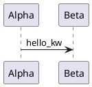

# groma.md and pumllint — a live C4 map from code, evaluated

*Dated evaluation, 2026-10-22, written against `64007cb` (v0.33.0 plus
docs, after #170). The question as posed: investigate
[groma.md](https://github.com/MrLesk/groma.md). Could it be used in the
context of pumllint? Would it bring benefits, solve problems, or improve
pumllint's position on the quadrant? A SWOT.*

**Verdict up front: nothing to adopt and nothing to build, and no
quadrant criterion moves. groma.md is a neighbour, not a part: it keeps
architecture as a model scanned from code and stored as Markdown in Git.
It emits no PlantUML, consumes none, and checks its own records by
construction rather than by rule. It meets pumllint in three ways:**

1. **As a source of `.puml` through a converter, measured with a probe.**
   groma's six curated flows become sequence diagrams that pass the
   pinned PlantUML and score Level 4 at 100/100 with zero findings, but
   only because groma's contract already enforced what pumllint would
   check. Under codegen they score Level 2, because a flow step is
   scenario prose by design. Its C4 views land at Level 1, as the
   2026-07-27 C4 settlement predicts.
2. **As the code side of diagram↔code conformance.** groma lowers the
   cost the 2026-07-26 settlement named, but only for the element
   inventory, not for interactions: on this repository's Python it
   derives zero relationships. The trigger has not fired.
3. **As a competitor.** It puts substitution pressure on hand-written C4
   only, which pumllint does not gate yet.

**The real yield is not about groma. The probe surfaced a parser defect:
a message sent by a participant named after a PlantUML keyword was
dropped, and SEQ002 then reported the receiver as declared but never
used. It is fixed in this PR for 32 of the 47 keywords that the pinned
jar draws as message senders. The other 15 are recorded.**

*Bounds: groma.md 0.7.2 (npm `latest`, linux-x64 binary), with
`@groma/scanner-python` 0.2.3, was **executed** on a scratch clone of this
repository at `64007cb`, never on the working tree. Its `init` writes into
`CLAUDE.md`, as §2 shows. Its source was read at `4f7ffac` (tag v0.7.6,
2026-10-21; v0.7.3–v0.7.6 are tagged but unpublished). Its own `groma/`
model was read as data. The PlantUML projection in §4 is a probe, not a
converter: no refusal, no sidecar, and two mapping choices that are
disclosed where they decide a result. Every pumllint figure was executed
at this PR's head. The syntax gate ran against PlantUML 1.2026.6, with its
sha256 checked against `tests.yml`'s pin. Adoption figures were read on
2026-10-22: the repository page (311 stars, 20 forks), npm's downloads API
(window 2026-09-19 to 2026-10-18), Backlog.md's page and npm count, and
pypistats for pumllint, whose window is the last 30 days and so is not
identical. The GitHub Action, the web viewer and Backlog.md were
characterized from documentation, not run. OKF was characterized from its
repository page.*

## 0. Why this ran, and what it is not

groma.md is three months old (first commit 2026-07-27) and appears in no
record here. The question touches six records that already carry most of
the answer:

- the C4-PlantUML settlement (2026-07-27): fit verified, wait for census
  pull; the census since read 0 of 39 on the one working-project corpus;
- the C4 ecosystem re-examination (2026-08-27): "modelling over
  diagramming" is the method's own stance, and three C4-capable validators
  exist, none of which grades;
- the Structurizr record (2026-08-27): a tool can be a *producer* of
  pumllint's artefact, and the generated-artefact principle says that
  findings on generated `.puml` are **true and unownable**;
- the adjacent-verifier settlement (2026-07-26): diagram↔code conformance
  is "nearest by asset, farthest by scope", watch, don't build;
- the positioning note (2026-08-28): the rubric, the inclusion rule, and
  a dated figure that is not re-scored one cell at a time;
- the graph-store record (2026-10-16): when a model lives outside a file,
  the surviving shape is an aris2puml-style converter emitting `.puml`,
  kept in its own repository.

What is new is a tool that scans code into a C4 model and keeps it live.
That is the code-side half every earlier record left unpriced. This note
is not a groma.md review. It asks where groma sits relative to
pumllint's boundary, and measures the one route between them that
exists.

## 1. What groma.md is

| | |
|---|---|
| What | A CLI with a browser map and a terminal map. It scans source into a first C4 model (systems, containers, components), which people or agents then curate. Save a file and the map updates. |
| Storage | One Markdown document per C4 element, with YAML frontmatter, in `groma/`, as a strict application profile of the [Open Knowledge Format](https://github.com/GoogleCloudPlatform/open-knowledge-format) v0.2 (Google Cloud Platform, Apache-2.0, 1.1k stars: "a universal, vendor-neutral format for representing knowledge as plain markdown files with YAML frontmatter"). Relationships are Markdown tables in the source element's document, whose endpoints are exact source files. Flows are `Groma Flow` documents with an ordered Steps table. |
| Scanners | 22 languages and frameworks, 12 marked available and 10 experimental, each an npm plugin. Deterministic, offline, and they call no AI service. Relationships are derived by two inference rules only (supplied named callbacks, certain HTTP requests), with *abstention* by design. Everything else is authored. |
| Checks | Contract validation on load: C4 containment, unique ids, every relationship row with a non-empty Description *and* Technology, and every flow step resolving an existing directed relationship. `groma lint` has one rule, possible duplicate logic in **source code**, and exits 1 on findings. |
| Outputs | The two interactive viewers, a static-site export, and a [GitHub Action](https://github.com/MrLesk/groma.md-action) (4 stars) that comments change counts and a before/after map link on PRs. **No diagram language at all**: the source tree holds no PlantUML, Mermaid, DOT or Structurizr writer. |
| Agents | `groma init` writes a managed `<!-- groma:start -->` block into `AGENTS.md` or `CLAUDE.md`. `groma agent-instructions` prints the task guides. A [Backlog.md](https://github.com/MrLesk/Backlog.md) work source pins tasks to the components they touch. |
| Runtime | TypeScript on Bun, shipped as native binaries through npm optional dependencies: linux x64/arm64, windows x64/arm64, darwin arm64 only. |
| Maturity | 0.7.2 on npm (2026-10-20). 1,082 commits between 2026-07-27 and 2026-10-21, 1,071 of them (99.0%) by one author, Alex Gavrilescu (MrLesk), who also maintains Backlog.md. Self-described "an early prototype". MIT. |
| Reach | 311 stars, 20 forks, 5,152 npm downloads in the window. Backlog.md: 7.1k stars, 88,640 downloads in the same window. pumllint, for scale: 1,028 PyPI downloads in the last 30 days. |

The manifesto states the boundary in one heading: **"Store architecture,
not diagrams"**, where diagrams are projections of the layered model. It
is the C4 method's "modelling over diagramming" again, now with the
model maintained from code.

## 2. On this repository, measured

`groma init "pumllint" --directory groma` on the scratch clone created
`groma/` and **appended a six-line managed block to `CLAUDE.md`**. That
is expected behaviour, and it is why nothing here ran on the working
tree.

- **The first scan wrote nothing.** `created 0, refreshed 0, matched 0`:
  the Python scanner parses every `*.py` file, and
  `stack_experiment/results/W3/wave_main/gen_yaml_opus_run1.py` is not
  Python. It is one of **15 recorded generation outputs** (3 under W3, 12
  under W3B) that are kept as generated, as evidence. One `SyntaxError`
  fails the whole scanner, and "a failed scanner does not start
  reconciliation". Excluding the six experiment and result directories in
  `groma/config.json` fixed it.
- **The second scan took about 10 s:** 1 system, **24 containers**, 69
  components, **0 relationships**, 0 actors, 0 externals, 39 findings.
  - Each container is an executable entry point: `pumllint/__main__.py`,
    `pumllint/cli.py`, and 22 scripts under `tools/`.
  - Each container holds one component, its entry module.
  - The other 45 components sit directly under the system, in groma's
    derived "Unidentified container". They include 35 of the product's
    own modules: parsers, rule packs, reporters, `engine.py`,
    `scoring.py`.
  - The scanner reported `PYTHON_SYNTAX_ONLY`: "call targets are
    unresolved, and imports are read only for HTTP facts". **For Python,
    groma derives no relationships**, so the map is a file inventory
    until someone authors the interactions.
- **`groma lint` exits 1 with 39 possible-duplicate groups.** Two were
  spot-checked. `engine._owning_diagram` and `fixer._owning` are the
  same span search, a real duplicate. `baseline.find_regressions` and
  `compute_deltas` only share a loop shape and compute different things.
  This is code hygiene, out of this note's scope, and not acted on.
- **The scanner printed pumllint's own `SyntaxWarning`**, an invalid
  `\`` escape in `parse_file`'s docstring that warns at every fresh
  compile. It is fixed in this PR, with a guard (§5).

The reading: on a Python repository, the first scan is an inventory, not
an architecture. That is groma's own claim: "the initial map is limited
to what the scanners can detect", and "review and curate the map at
least once".

## 3. At its best: groma's own curated model

groma's repository carries its own architecture, curated over three
months. It is the best evidence available of what the tool produces when
it is used as intended. Read at `4f7ffac`:

| | count | completeness |
|---|--:|---|
| Documents | 134 | |
| C4 Actor | 2 | description 2/2 |
| C4 System | 1 + 3 external | description 4/4 |
| C4 Container | 5 | description 5/5, technology 5/5 |
| C4 Component | 115 | description **112/115**, technology **4/115** |
| Groma Flow | 6 | 23 steps |
| Relationship rows | 60 | **42 authored**, 18 derived, 0 draft |

Two facts carry forward. **70% of the relationships are authored, not
derived**, even on groma's own TypeScript, the language its scanners
serve best. So "the as-built side" is mostly hand-written prose with file
links, not evidence. And component technology is filled on 3.5% of
components. That is a C4 review-checklist item (element technology) that
groma's contract makes optional and its curators mostly skip. A C4 pack
would report it, and the generated-artefact principle says the finding
belongs on the Markdown record, not on a projection.

## 4. The probe: groma onto PlantUML, measured

The probe (§11) reads the bundle and writes two projections:

- **one C4-PlantUML component view per container.** Each view is
  `Component(...)`, plus `Rel(...)` from the authored and derived tables,
  with file endpoints resolved to their owning components through
  `groma.code`;
- **one sequence diagram per flow**, with actors as `actor`, everything
  else as `participant`, and one message per step in table order.

That makes 11 files from the 134 documents, with 59 cross-component
relationships resolved. Measured at this PR's head:

| Projection | Files | Typed | Default profile | `--profile codegen` |
|---|--:|---|---|---|
| C4 component views | 5 | `unknown`, 0 elements | **Level 1**, 100.0 (zero-element cap) | Level 1, 100.0 |
| Flows, PascalCase aliases | 6 | `sequence` | **Level 4, 100/100, zero findings** | **Level 2, 45/100**: SEQ102 ×23, SEQ103 ×23 (blocker), SEQ104 ×23 |
| Flows, snake_case aliases | 6 | `sequence` | Level 4, 91.7–91.8: GEN004 ×29 | (not run) |
| Model set | 11 | | Level 1 (worst-of) | Level 1, 49.8 |

All 11 files pass the pinned PlantUML (`score --check-syntax`, levels
unchanged), `!include <C4/C4_Component>` included.

- **The C4 row is the settlement's prediction, confirmed a third
  time**, after the C4 note's own samples and Structurizr's C4-PlantUML
  export. It is honest, and it is useless: pumllint has no C4
  pack, and the zero-element cap is what keeps a vacuous 100 from
  claiming anything.
- **The default flow row is prevention, not quality.** Zero findings
  because groma refused to store anything a sequence rule here would
  catch:
  - every step resolves an existing relationship, so there is no
    message to nowhere;
  - every step's Action must be non-empty text, so there is no
    unlabelled message;
  - every endpoint is a declared element, so there is no undeclared
    participant.

  This is Structurizr's lesson from 2026-08-27 ("its design absorbed the
  problem"), reached from a second model-first tool.
- **The snake_case row is a converter's choice, not a fact about
  groma.** groma ids are kebab-case. The probe's first alias rule (`-` to
  `_`) trips GEN004 on every participant, and PascalCase silences it.
  This is the generated-artefact principle's third instance, after
  ArchiMate and Structurizr, cited rather than re-derived: the findings
  are true, and the only fix sits in the converter or upstream.
- **The codegen row is the right answer about the wrong artefact.** A
  groma flow step's Action "explains what happens in this scenario"; it
  is narrative by contract, never a signature. SEQ103 (signature shape)
  and SEQ104 (explicit return) fire on every one of the 23 messages, and
  SEQ102 (typed role) on every one of the 23 non-actor participants. groma flows are
  documentation-grade sequence diagrams, and pumllint says so.
- **Before the fix in §5**, the snake_case run also carried one SEQ002:
  `scanner_package_registry` "declared but never used", on a diagram
  whose last message is `package -> scanner_package_registry`.

## 5. The defect the probe found, fixed in this PR

`_LIKELY_KEYWORD_SOURCES` in `pumllint/parser/sequence.py` dropped every
message whose source was one of 53 PlantUML keywords, whether or not the
source was a declared participant. groma derives component ids from file
stems, and its `package.ts` component is `package`. So
`participant "Plugin packages" as package` followed by
`package -> scanner_package_registry : …` lost its message, and SEQ002
reported the receiver as unused. The finding is false, and every
message rule is blind to the line.

Ground truth came from the pinned jar, by rendering 106 files to SVG and
counting `<g class="message">` elements. The files cover each of the 53
words, as a declared alias and undeclared, each followed by
`<kw> -> b : x`:

- PlantUML 1.2026.6 draws **47 of the 53 words** as a real message from
  a participant of that name, in both forms (the SVG's `data-entity-1`
  is the keyword's lifeline);
- for the other six, the directive wins over the arrow: `caption`,
  `footer`, `header`, `legend`, `mainframe`, `title`;
- pumllint agreed with the jar on **12 of 106 files**: the six directive
  words, both forms.

**The fix**: the guard now holds those six words only. Agreement rises
to **76 of 106**. The remaining **30 files are 15 words**, whose lines
an earlier branch claims before the message branch is reached:

- `alt`, `opt`, `loop`, `par`, `break`, `critical`, `group`, `else` and
  `box` open or split a block;
- `note`, `hnote` and `rnote` start a note;
- `return` is a return;
- `autonumber` and `skinparam` are directives.

PlantUML draws all 15 as messages. Making the parser agree means
reordering five places, including the note pre-pass. That is recorded
under Arc A as a residual and not changed here: the 93 diagrams in this
repository hold **no** participant named after any of the 53 words, and
the one occurrence observed is a generated alias.

The tests pin both directions (`tests/test_parser_sequence.py`):

- 32 words parse as messages, declared and undeclared;
- six directives still produce none.

The first test fails against the old parser. The second passes on both,
because it pins behaviour that did not change. The same
commit escapes the docstring backslash, and adds
`test_package_sources_compile_without_warnings`, which compiles every
module under `pumllint/` with warnings recorded. No golden, schema or
score moved: 739/739 stdlib tests and 877 pytest tests pass.

## 6. Three readings

### 6.1 groma as a producer, through a converter: works, low yield, and the shape is already recorded

groma emits no PlantUML, so any route needs a converter. The graph-store
record already fixed its shape: it emits `.puml`, lives in its own
repository under aris2puml's iron rules (refuse with the element named,
preserve defects, record drops in a sidecar), and returns identity
through a line → id map. The probe shows what such a converter would
deliver:

- flows that gate clean by construction at default, and fail codegen
  for a reason that is not a defect;
- C4 views that level nothing until a C4 pack exists, and once one
  exists, findings (technology on 4 of 115) whose fix is
  `groma edit --technology` on the Markdown, not on the `.puml`.

*Recorded, not queued. Trigger: an adopter who keeps architecture in
groma and asks for its flows or views to pass pumllint's gate. groma
output does not fire the C4 pack's census trigger either: the
settlement's niche is "hand-written C4-PlantUML files only", and a
projection is not one.*

### 6.2 groma as the code side of diagram↔code conformance: the cost moves, the gate does not

The 2026-07-26 settlement declined conformance because it "requires
parsing implementation languages, straining the zero-dependency
promise". groma removes the parsing from pumllint's process entirely: 22
scanners, out of process, writing Markdown that names exact files. That
is the "lighter cousin" shape the 2026-07-29 specification-stack record
gave the sequence↔contract cross-check (machine-readable data, not an
implementation language). Three measured facts keep it on the shelf:

- **Interactions are mostly not evidence.** 0 derived relationships on
  this repository's Python, and 18 of 60 on groma's own TypeScript. A
  diagram's messages checked against groma's relationships would mostly
  compare authored prose with authored prose.
- **The join is a name join.** Component ids are file stems (`engine`,
  `config`, `package`), and titles are curated prose ("Command
  interface"). Diagram participants carry neither. The 562 → 0 lesson
  and Step-to-model's G2 apply: such a join is declared, never
  defaulted, so an adopter would maintain a mapping.
- **The frontmatter is YAML.** The stdlib does not parse it, so the
  dependency strain moves rather than vanishes. PyYAML is already the
  optional extra for YAML configs, which would carry it, but it would be
  a second reason to need it.

groma's own draft → accept lifecycle is already plan↔code conformance
for groma's own model ("`groma accept` applies a ghost only when a scan
has matched it"), and jQAssistant's C4 plugin occupies the C4-PlantUML
slot. *Trigger unchanged: a user asking to gate PRs on model↔code
drift. The 2026-07-26 bullet is annotated in place to name groma as the
code-side neighbour.*

### 6.3 groma as a substitute: pressure on hand-written C4, not on the core

groma, the C4 method, Structurizr and LikeC4 all point the same way:
store a model, project the pictures. An adopter running groma has no
hand-written C4-PlantUML to gate. That lowers further the demand behind
a C4 pack that is already census-gated at 0 of 39. It does not touch
what pumllint gates today:

- sequence, activity, class, state and use-case diagrams. groma's only
  behavioural artefact is the flow, an ordered list of steps with no
  branches, loops or alternatives;
- cross-diagram identity (XD), which groma's single model makes
  inexpressible, the Structurizr pattern again;
- the maturity layer.

The agent channel is the larger pressure. groma's whole loop has an
agent curating Markdown records through a CLI, and it rides Backlog.md's
reach. Where that loop wins, the architecture artefact an agent writes is
OKF Markdown, not a `.puml`, and docs/agents.md's gate has less to gate
on the structural side. groma is 87 days old, so this is a direction,
not a measurement.

## 7. Does it solve an open problem?

No. Each of the 17 open checkboxes waits on its own gate, and groma
fires none of them:

- **Arc C** (further coverage, XD member coherence, XD display-name
  identity, `ref over`) waits for a census pull, a second corpus showing
  the defect, an adopter's alias inconsistency, or a `trace` user. groma
  projections are generated and model-first, and its single model has no
  aliases.
- **Arc D's foreign-corpus fixture** waits for an adopter's
  hand-authored corpus, and six generated flows are not one.
- **Arc E's Sonar plugin and run provenance** wait for a Sonar-shop
  user, and for an adopter keeping reports as evidence.
- **Arcs F, G, H, I and J** wait for their own triggers, none of which
  is architecture recovery.

The one thing that did get solved, the keyword-alias defect, was
pumllint's problem, found by pointing pumllint at a new producer.

## 8. The quadrant

**groma.md is not a dot.** The field's inclusion rule (§2 of the
[positioning note](positioning-quadrant.md)) is "tools whose job is to
deterministically check a textual diagram-as-code artefact". groma fails
it twice, and either failure would be enough. Its job is maintaining a
model, not checking an artefact. And its artefact is OKF Markdown, which
falls in the "model-side validators of non-diagram artefacts" class the
note excludes. Its `lint` checks source code. The positioning note is
annotated in place with this exclusion.

**pumllint's dot does not move**, criterion by criterion:

| Criterion | Score (2026-08-28) | What groma could change |
|---|--:|---|
| V1 syntax validity | 4 | nothing: the gate is PlantUML's, and groma never touches syntax |
| V2 rule layer | 5 | saturated |
| V3 semantics & consistency | 5 | saturated |
| V4 governance & measurement | 5 | saturated |
| E1 maturity & stability | 2 | nothing: earned by pumllint's own contracts and 1.0 evidence |
| E2 adoption & reach | 1 | nothing *observed*. A converter would widen the gateable footprint only after it exists and is used, and §6.3 says model-first tools narrow the hand-written-C4 footprint over time |
| E3 integrations | 4 (*the cell that moves on a re-issue, since the LSP*) | nothing: CI, pre-commit, editors and dashboards are the criterion, and a converter to a 0.7 tool is none of them |
| E4 sustaining backing | 2 | nothing |

The vision axis is saturated at 19 of 20. Its one missing point (V1)
is the optional syntax gate, which groma cannot touch. Execution is
earned, not integrated. The positioning
note's own §5 says which two numbers the project "can only earn, not
write", and an integration with a three-month-old single-author tool
writes neither.

*Illustrative only, not added to the figure:* if groma were forced onto
the chart on its checking layer, under the Structurizr dagger rule, it
would score:

- vision: V1 5 (the authoritative reader of its own profile), V2 0
  (one rule, about code), V3 2 (referential integrity by construction),
  V4 0, for **7**;
- execution: E1 1, E2 2, E3 3, E4 1 (one author), for **7**.

That places it among the Niche Players, beside `@probelabs/maid`. It is
also the **fourth C4-capable validator that does not grade**, after
Structurizr, LikeC4 and Linked.Archi's SHACL. The C4 ecosystem record's
"none of them grades" holds from a fourth direction.

## 9. SWOT: groma.md in pumllint's context

**Strengths** (what groma brings to a combination):

- deterministic, offline, and calling no AI service, the same product
  ethos as the deterministic product path;
- its contract enforces several C4 checklist items (relationship
  description and technology, containment, resolvable flow steps) by
  refusal rather than by finding;
- 22 language scanners write a code-derived element inventory with exact
  file evidence, which is the cost the conformance settlement declined to
  pay;
- architecture lives in Git and is reviewed in the same PR as the code,
  with an Action that diffs it on PRs;
- a clean projection: 11 of 11 probe files are grammar-valid, and the
  flows score Level 4 at 100/100;
- a maintainer with a proven adoption record (Backlog.md, 7.1k stars,
  88.6k downloads a month).

**Weaknesses** (what it lacks for pumllint's purposes):

- no diagram-language output of any kind, so every route starts with a
  converter nobody has written;
- Python relationships are syntax-only: 0 derived on this repository.
  Derived interactions are narrow by design (18 of 60 even on its own
  TypeScript), so the "as-built" side is mostly authored;
- the first scan is an inventory: 24 entry-point containers and 35
  product modules with no container, here;
- one unparseable file fails a whole scanner: 15 recorded generation
  outputs in this repository needed an exclusion before anything was
  written;
- 0.7.x, 87 days old, 99% one author, self-described early prototype,
  releasing fast (v0.7.0 to v0.7.6 between 2026-10-17 and 2026-10-21);
- flows are linear step lists, with no alternatives or loops, so they
  map to the thinnest sequence diagrams pumllint scores.

**Opportunities:**

- the defect it surfaced is fixed, and generated aliases (file stems,
  ids) are exactly where keyword-named participants appear, so every
  future converter benefits;
- if an adopter keeps architecture in groma and wants the gate, the
  converter shape is recorded and the probe sizes it;
- a code-side partner for conformance exists without pumllint parsing
  code, if the drift-gating trigger ever fires;
- groma's own repository is a public, MIT-licensed, curated C4 model:
  a ready fixture for a C4 pack's tests if one is ever built (not a
  demand signal);
- it gives one more independent data point that no C4-capable validator
  grades.

**Threats:**

- substitution on the structural layer: "store architecture, not
  diagrams", with the model kept live from code, removes hand-written
  C4-PlantUML where it is adopted;
- the agent loop moves agent-written architecture from `.puml` to OKF
  Markdown, riding Backlog.md's reach;
- a bridge would encode a fast-moving 0.x third-party profile as a
  contract to track. That is the reason the Structurizr record gave for
  never building an exporter-specific profile;
- findings on projections are true and unownable: the
  generated-artefact principle, in its third instance;
- licences are no blocker for a CLI-to-CLI route (MIT beside
  GPL-3.0-or-later). But bundling pumllint inside a groma plugin would
  bring GPL-3.0 obligations to that plugin, so any bridge stays
  process-separated.

## 10. Decision

- **Adopt:** nothing. **Build:** nothing new. No checkbox is added, and
  the open count stays at 17, all gated.
- **Shipped in this PR:** the keyword-alias parser fix with its tests,
  and the docstring escape with its compile guard. Unreleased; they land
  in the next version.
- **Recorded, not queued:**
  - the 15-word residual of the fix (Arc A);
  - the converter shape for groma, which is the graph-store record's
    shape with groma as its first named producer.
- **Annotated in place, as pointers:**
  - the 2026-07-26 diagram↔code bullet, naming groma as the code-side
    neighbour, with its measured limits;
  - the positioning note's exclusions.
- ***Never build*, in this question's vocabulary:**
  - an OKF or groma reader inside pumllint;
  - a groma-specific profile or recognizer;
  - rules over OKF Markdown, a non-PlantUML artefact, whatever its
    content.
- **Re-litigate on:**
  - an adopter keeping architecture in groma and asking for the gate;
  - a user asking to gate PRs on model↔code drift (unchanged);
  - groma shipping a PlantUML or C4-PlantUML export, which makes it a
    producer with no converter needed;
  - groma's `lint` growing rules over architecture records *and* a
    grade, which would contest "no C4-capable validator grades";
  - groma becoming a real adoption channel, observed in an adopter's
    repository rather than inferred from download counts.
- **Priorities unchanged.** The critical path stays aris2puml A1b → A4.

## 11. Reproducing

All commands run outside the working tree. `$S` is a scratch directory.

```bash
# groma.md: install, init on a clone, scan, lint
cd "$S" && npm init -y >/dev/null && npm i groma.md@0.7.2
git clone -q /path/to/pumllint pl && cd pl
"$S/node_modules/.bin/groma" init "pumllint" --directory groma   # appends to CLAUDE.md
"$S/node_modules/.bin/groma" plugin add @groma/scanner-python      # 0.2.3
"$S/node_modules/.bin/groma" scan          # created 0: one non-Python .py fails the scanner
# add "exclude": ["stack_experiment/", "c4_experiment/", "c4_experiment_results/",
#   "experiment_results/", "execution_results/", "pilot_results/"] to groma/config.json
"$S/node_modules/.bin/groma" scan          # created 94 ... findings 39
"$S/node_modules/.bin/groma" view --plain  # Relationships: none
"$S/node_modules/.bin/groma" lint; echo $? # 39 groups, exit 1

# the probe over groma's own model (clone github.com/MrLesk/groma.md at 4f7ffac)
python -I groma_probe.py groma.md/groma out/                 # snake_case aliases
ALIAS=pascal python -I groma_probe.py groma.md/groma outp/   # PascalCase aliases
pumllint score outp/ --check-syntax        # needs `plantuml` on PATH (1.2026.6)
pumllint score --profile codegen outp/
pumllint out/                              # GEN004 x29 (and SEQ002 x1 before the fix)
```

The keyword ground truth: for each word `kw` in the old guard, write



and its undeclared twin (without the first participant line), render with
`java -jar plantuml-1.2026.6.jar -tsvg`, and count `<g class="message"`
per SVG. Then compare with `len(parse_file(path)[0].messages)`.

<details>
<summary>The probe, <code>groma_probe.py</code> (needs PyYAML)</summary>

```python
"""Probe: project a groma.md OKF bundle onto PlantUML, to measure what pumllint makes of it.

Not a converter: no refusal, no sidecar. Two projections only:
  * one C4-PlantUML component view per container (Component + Rel from the
    relationship tables, file endpoints resolved through groma.code ownership);
  * one sequence diagram per Groma Flow (Steps table, in order).
Usage: python -I groma_probe.py <groma-root> <out-dir>
"""
import os, re, sys
import yaml

root, out = sys.argv[1], sys.argv[2]
os.makedirs(out, exist_ok=True)
docs = {}
for d, _, fs in os.walk(root):
    for f in fs:
        if not f.endswith(".md"):
            continue
        p = os.path.normpath(os.path.join(d, f))
        text = open(p, encoding="utf-8").read()
        m = re.match(r"---\n(.*?)\n---\n(.*)", text, re.S)
        if not m:
            continue
        fm = yaml.safe_load(m.group(1)) or {}
        docs[p] = (fm, m.group(2))

alias = (lambda gid: "".join(w.capitalize() for w in gid.split("-"))) if os.environ.get("ALIAS") == "pascal" else (lambda gid: gid.replace("-", "_"))
q = lambda s: (s or "").replace('"', "'")
by_id, owner = {}, {}
for p, (fm, body) in docs.items():
    g = fm.get("groma") or {}
    if "id" in g:
        by_id[g["id"]] = (p, fm)
    for c in g.get("code") or []:
        owner[os.path.normpath(c["file"])] = g.get("id")

def rows(body, section):
    m = re.search(r"^## " + section + r"\n(.*?)(?=^## |\Z)", body, re.S | re.M)
    if not m:
        return []
    out_rows = []
    for line in m.group(1).splitlines():
        cells = [c.strip() for c in line.strip().strip("|").split("|")]
        if len(cells) >= 3 and not set(cells[0]) <= set("- ") and cells[0] not in ("Source", "From"):
            out_rows.append(cells)
    return out_rows

link = re.compile(r"\[[^\]]*\]\(<?([^)>]+)>?\)|\[[^\]]*\]\[([^\]]+)\]")
def target(cell, doc_path, body):
    m = link.search(cell)
    if not m:
        return None
    href = m.group(1)
    if href is None:
        d = re.search(r"^\[" + re.escape(m.group(2)) + r"\]:\s*(\S+)", body, re.M)
        href = d.group(1) if d else None
    if href is None:
        return None
    return os.path.normpath(os.path.join(os.path.dirname(doc_path), href))

repo = os.path.dirname(os.path.normpath(root))
def owner_of(path):
    rel = os.path.relpath(path, repo)
    if rel in owner:
        return owner[rel]
    if path in docs:
        return (docs[path][0].get("groma") or {}).get("id")
    return None

# component views
rels = []
for p, (fm, body) in docs.items():
    for sec in ("Relationships", "Derived relationships"):
        for cells in rows(body, sec):
            s, t = owner_of(target(cells[0], p, body) or ""), owner_of(target(cells[1], p, body) or "")
            if s and t and s != t:
                rels.append((s, t, cells[2], cells[3] if len(cells) > 3 else ""))
containers = [(g["id"], fm) for p, (fm, _) in docs.items()
              for g in [fm.get("groma") or {}] if fm.get("type") == "C4 Container"]
for cid, cfm in containers:
    comps = [(g["id"], fm) for p, (fm, _) in docs.items()
             for g in [fm.get("groma") or {}] if fm.get("type") == "C4 Component" and g.get("parent") == cid]
    ids = {i for i, _ in comps}
    lines = ["@startuml " + alias(cid) + "-components", "!include <C4/C4_Component>",
             "title " + q(cfm.get("title")) + " - components", ""]
    lines.append('Container_Boundary(%s, "%s") {' % (alias(cid), q(cfm.get("title"))))
    for i, fm in sorted(comps, key=lambda x: x[0]):
        lines.append('  Component(%s, "%s", "%s", "%s")' % (alias(i), q(fm.get("title")),
                     q((fm.get("groma") or {}).get("technology")), q(fm.get("description"))))
    lines.append("}")
    seen = set()
    for s, t, desc, tech in rels:
        if s in ids and t in ids and (s, t) not in seen:
            seen.add((s, t))
            lines.append('Rel(%s, %s, "%s", "%s")' % (alias(s), alias(t), q(desc), q(tech)))
    lines.append("@enduml")
    open(os.path.join(out, "c4-" + cid + ".puml"), "w", encoding="utf-8", newline="\n").write("\n".join(lines) + "\n")

# flows
for p, (fm, body) in docs.items():
    if fm.get("type") != "Groma Flow":
        continue
    fid = fm["groma"]["id"]
    steps = rows(body, "Steps")
    parts, msgs = [], []
    for cells in steps:
        a, b = target(cells[0], p, body), target(cells[1], p, body)
        pa, pb = docs.get(a), docs.get(b)
        if not pa or not pb:
            continue
        for x in (pa, pb):
            if x not in parts:
                parts.append(x)
        msgs.append((pa[0]["groma"]["id"], pb[0]["groma"]["id"], cells[2]))
    lines = ["@startuml " + fid, "title " + q(fm.get("title")), ""]
    for fm2, _ in parts:
        kw = "actor" if fm2.get("type") == "C4 Actor" else "participant"
        lines.append('%s "%s" as %s' % (kw, q(fm2.get("title")), alias(fm2["groma"]["id"])))
    lines.append("")
    for a, b, act in msgs:
        lines.append("%s -> %s : %s" % (alias(a), alias(b), act))
    lines.append("@enduml")
    open(os.path.join(out, "flow-" + fid + ".puml"), "w", encoding="utf-8", newline="\n").write("\n".join(lines) + "\n")
print(len(docs), "docs;", len(containers), "containers;", len(rels), "resolved cross-component rels")
```

</details>

## Related reading

- [The C4 model ecosystem, re-examined](c4-ecosystem-evaluation.md):
  modelling over diagramming, the three validators that do not grade, and
  F4, the conformance slot jQAssistant occupies.
- [C4-PlantUML pack: fit evaluation](c4-pack-evaluation.md): the Level-1
  prediction the probe's C4 row confirms.
- [The Structurizr DSL ecosystem, re-examined](structurizr-dsl-ecosystem-evaluation.md):
  the producer reclassification and the generated-artefact principle.
- [Running pumllint on a graph store (Neo4j), evaluated](graph-store-evaluation.md):
  the converter shape §6.1 reuses.
- [Positioning pumllint](positioning-quadrant.md): the rubric and the
  inclusion rule §8 applies.
- [Where tooling pays](sdlc-tooling-landscape.md): diagram↔code
  conformance among the adjacent oracle gaps.
- aris2puml's README and CLAUDE.md: the iron rules a groma converter
  would inherit.
