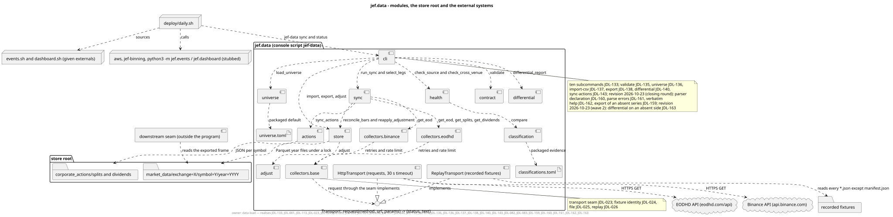
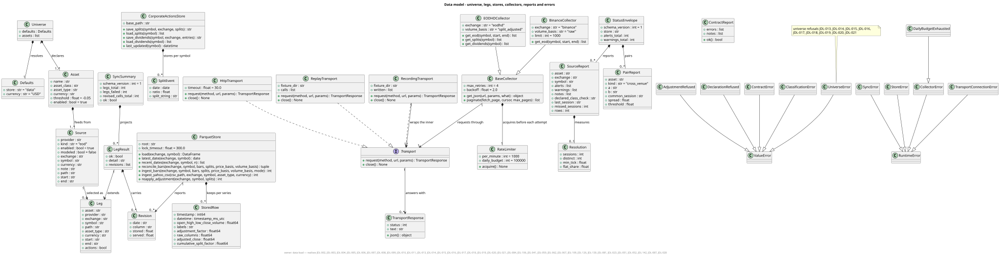
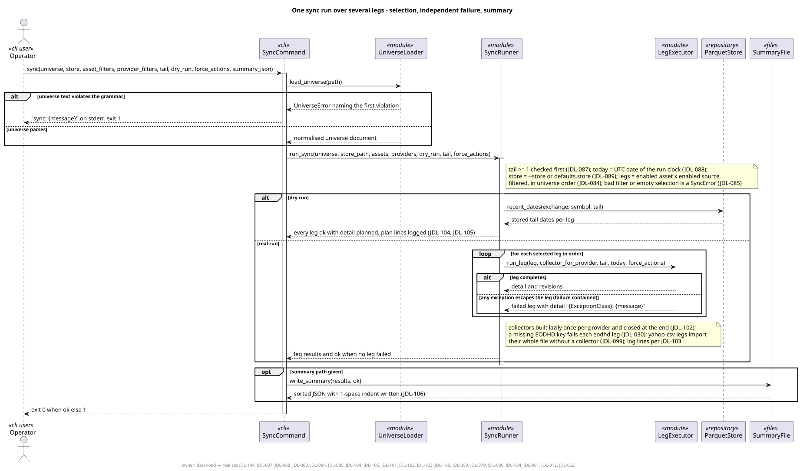
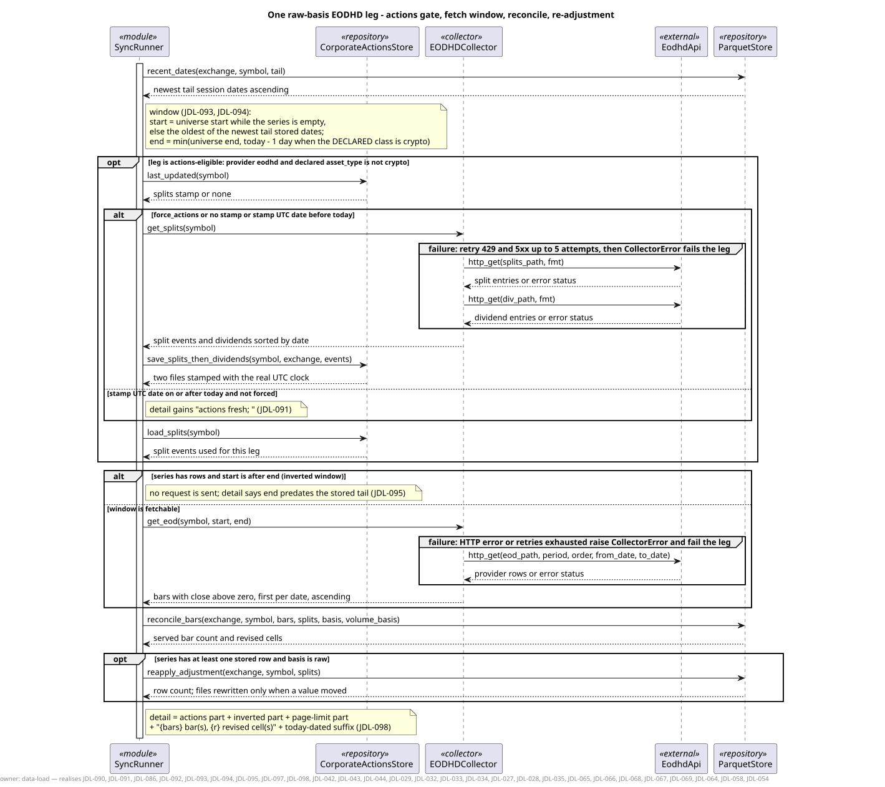
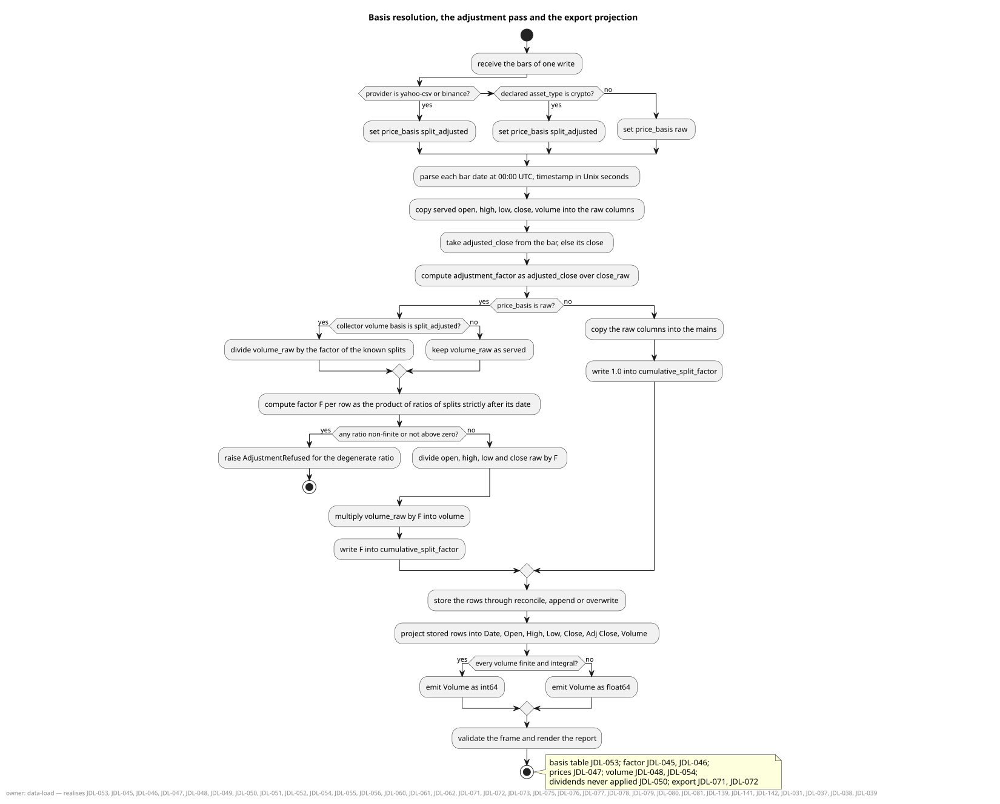
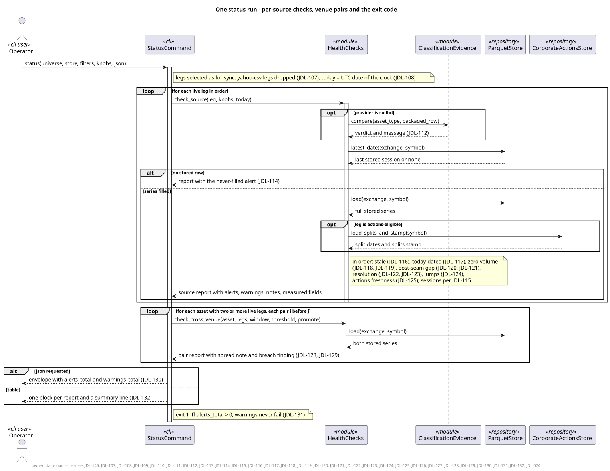
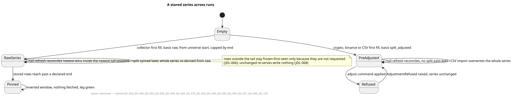
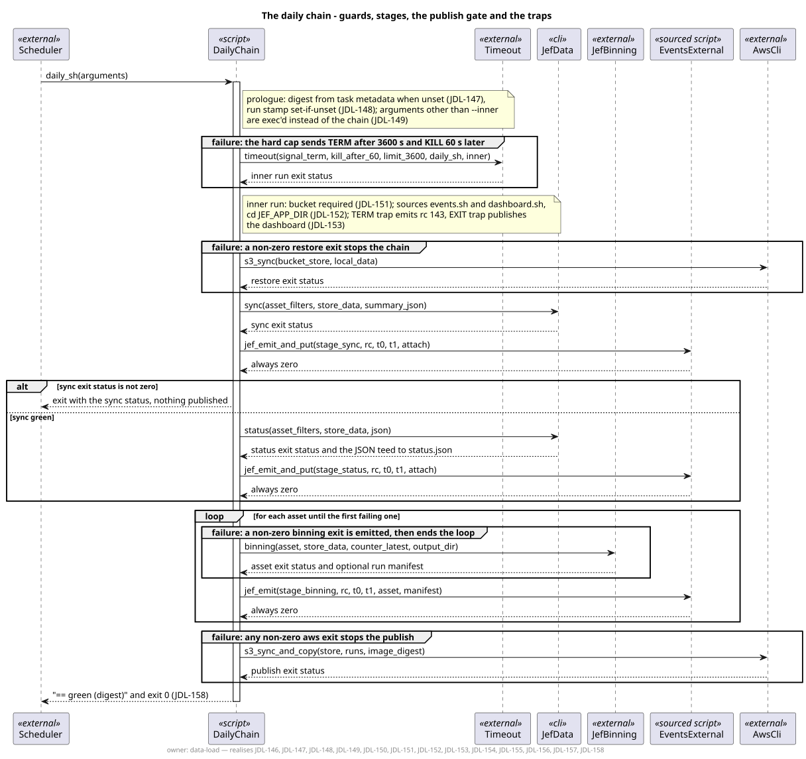

# Architecture, in eight diagrams

The diagrams are the kit's `../kit/uml/*.puml`, rendered to `diagrams/`.
Each footer names the requirements it realises (`TRACE.md` lists them).
They were scored "Level 5, method-complete" by pumllint, meaning every
message names its operation and every branch its condition; they are
precise enough to build from, and the acceptance suite is what proves a
build right, not the diagrams.

## 1. The modules and their neighbours

One package, `jef.data`, with a console script `jef-data`. `cli` parses ten
subcommands and dispatches. `universe` loads and validates the declaration
of assets and sources. `sync` runs the acquisition ritual leg by leg,
through `actions` (corporate actions), `store` (Parquet partitions under a
lock), `adjust` (the split arithmetic) and the two collectors, which share a
base with retries and rate limiting and talk HTTP through one transport
seam, so a replaying transport can stand in for the network. `health`
computes the status report, `contract` validates an exported frame,
`differential` compares two series, `classification` checks declared
classes against packaged vendor evidence. The chain script sits above and
calls `jef-data sync` then `jef-data status`.

## 2. The data model

What a universe, an asset, a source and a leg are; the stored row with its
21 columns; the corporate-actions files; the collectors and transports; the
two report documents (`sync --summary-json`, `status --json`, both pinned
by JSON Schemas in `../kit/contracts/`); and every error class with where it
is raised. Read it beside `../kit/contracts/store.md` §4, which gives the
column-by-column meaning and dtype.

## 3. One sync run

Selection of legs in universe order, the dry-run plan, one leg after
another with independent failure (a failed leg is logged `FAILED` and the
next leg runs), the log lines, the revision echo, and the summary document.
The exit code is 1 when any leg failed, 0 otherwise.

## 4. One raw-basis EODHD leg

The leg that does the most: the actions gate (refresh splits and dividends
once per UTC day, or when forced), the fetch window (first fill from the
declared start, or the tail of the newest N stored sessions; the end capped
by the declared end and, for crypto, by yesterday), the reconcile into the
store (served rows replace stored rows whose raw columns differ), and the
re-adjustment of the whole series from its raw columns with the stored
splits. `DECISIONS.md` has the gate and the window as tables.

## 5. Basis resolution, adjustment and the export projection

How the provider and the declared asset class decide whether a series is
stored raw (and adjusted on read-back by the cumulative split factor) or
already split-adjusted; the arithmetic of `close = close_raw / F`,
`volume = volume_raw × F`; and how a stored row becomes the seam frame the
downstream model reads. The worked example in `../kit/contracts/adjustment.md`
§6 gives every intermediate number for a two-split equity.

## 6. One status run

Per source, in a fixed order: declared class, never filled, staleness,
today-dated bar, zero volume, post-seam continuity, price resolution,
phantom-split jumps, corporate-actions freshness; then per venue pair the
cross-venue close spread. Alerts set exit 1; warnings and notes never do.

## 7. A stored series across runs

Absent → filled by a first fill or an import → refreshed by tail reconciles
→ re-adjusted when a split is learned; an import always replaces the whole
series. `DECISIONS.md` "command_by_store_state" says what every command
does in each state, including the two that end in an unhandled traceback.

## 8. The daily chain

`deploy/daily.sh`: the image-digest prologue, the exec guard, the bucket
guard, the stages in order (restore, sync, status, binning, publish) each
with a timeout and a ledger line, the publish gate on green, and the TERM
trap. `events.sh` and `dashboard.sh` are given; the chain only calls them.
