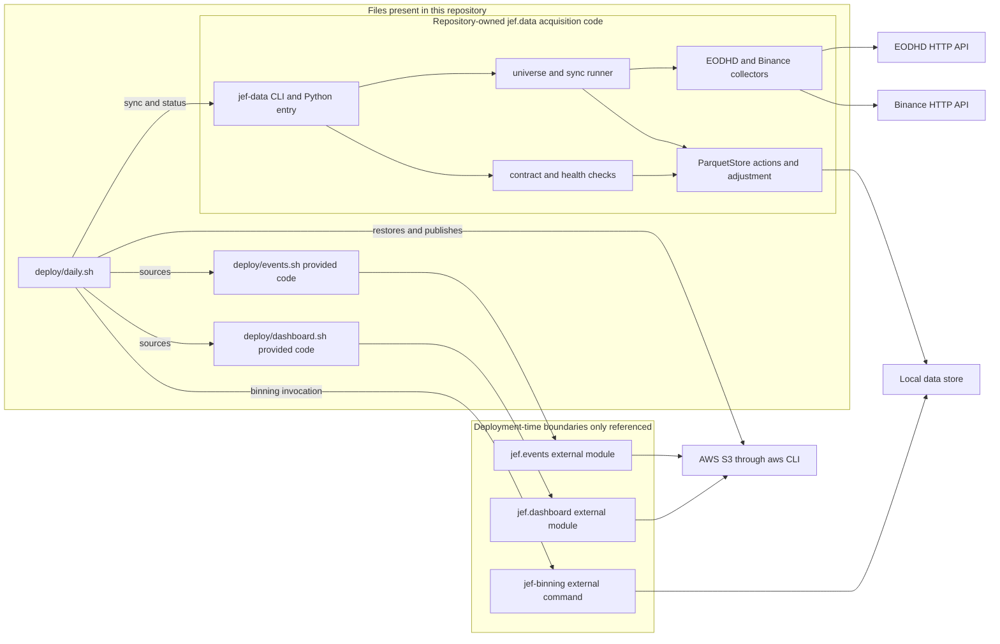

# Data Layer Boundaries and Public Surfaces

`jef.data` is the repository-owned EOD acquisition and local-persistence subsystem. It turns configured EOD sources into a local, partitioned store; preserves the adjustment audit trail; and evaluates local-store health. It is **not** the modeling/binning implementation, event ledger, dashboard implementation, cloud scheduler, or an S3 client library.

This boundary matters operationally: the daily script composes those pieces into one gate, but composition is not ownership. In particular, a command mentioned by `daily.sh` is not evidence that its Python implementation is in this repository.

For data meaning and adjustment mechanics, see [EOD Data Model and Adjustment](../concepts/eod-data-model-and-adjustment.md). For the complete scheduled procedure, see [Daily Run and Publication](../operations/daily-run-and-publication.md).

## Ownership map

*The diagram separates the owned `jef.data` code and its local store from provider APIs and from deployment-time commands or modules whose implementations are only referenced.*

### What is owned here

The package build discovers only `jef.data*` under `src` and exposes the `jef-data` console script. Its owned responsibilities are:

- validate the seven-column EOD interchange contract;
- parse and validate the declarative universe, choose selected source legs, acquire or import them, and make their update order explicit;
- normalize provider bars, retain raw and derived values, persist the local store, reapply split adjustment, reconcile a recent tail, and render an export frame;
- perform offline health checks and provider-difference reporting; and
- provide provider collector plumbing, including token handling, rate limiting, retries, and replay/recording transports.

`deploy/daily.sh` is present and calls `jef-data`; it is the integration owner for the daily chain. It also sources `deploy/events.sh` and `deploy/dashboard.sh`. Those two files are physically present to make that chain readable, but `deploy/EXTERNALS.md` explicitly classifies them as given, verbatim venue telemetry and publishing legs rather than part of the subject. Treat their behavior—and the modules they execute—as external integration contracts, not `jef.data` implementation details.

### What is not supplied by this repository

The following are boundaries, even though the deployment scripts name them:

| Boundary | Evidence in this repository | Safe interpretation |
| --- | --- | --- |
| `jef-binning` | `daily.sh` invokes it once per asset with `--asset`, `--store`, `--counter-start latest`, `--counter-end latest`, and `--output-dir`. | The acquisition store is an input to binning. No `jef.binning` source or binning CLI implementation is packaged here; do not infer its flags, storage reads, or model behavior beyond this invocation. |
| `jef.binning.loading` | `jef.data` documentation and CLI help name it as the store-loading seam. | The data layer deliberately supplies a storage-facing representation while the binning layer remains storage-agnostic. The consumer implementation is external to this checkout. |
| `python3 -m jef.events emit` | The supplied event shell helper calls it to append stage records. | Ledger schema, event implementation, and telemetry delivery semantics belong to the venue component. The helper deliberately makes telemetry failures non-gating. |
| `python3 -m jef.dashboard publish` | The supplied dashboard helper invokes it with events, store, output, run date, and snapshot output paths. | Dashboard/read-model behavior is external. Its helper publishes as best-effort telemetry and must not alter the run result. |
| AWS CLI, S3, ECS metadata, scheduler | `daily.sh` uses `aws` and optionally reads ECS task metadata; the script notes that EventBridge scheduling is declared elsewhere. | These are runtime infrastructure dependencies rather than Python package dependencies. |

The absence of an implementation is significant when changing interfaces: make a compatibility change to the handoff only with the external component’s contract and deployment image in view.

## Public entrypoints

### Console and module entrypoints

`jef-data` resolves to `jef.data.cli:main`; `python -m jef.data` calls the same `main()`. The argparse shell is intentionally thin and imports modules that need network or Parquet support only when their command is selected. This permits contract validation to remain useful without loading the persistence or HTTP stack.

| Command family | Intended boundary and behavior |
| --- | --- |
| `validate CSV` | Validates the raw seven-column EOD contract and returns 1 only for contract errors. Notes describe rows that the downstream seam will drop or normalizations it will perform. |
| `universe` | Reads the packaged universe or `--universe` override and prints the normalized configured assets and sources. |
| `sync` | The batch acquisition entrypoint. It selects configured legs, uses the local store, optionally writes a machine-readable `--summary-json`, and returns nonzero if any leg failed. `--dry-run` computes the plan from local state and creates no provider collectors. |
| `status` | Offline local-store health gate. It returns 1 for alerts, not warnings; `--json` emits a schema-versioned envelope with per-source reports, cross-venue pairs, and alert/warning totals. |
| `sync-actions`, `load`, `adjust`, `import-csv`, `export`, `differential` | Focused operator and repair/interchange tools. They expose individual steps but do not replace the configured `sync` ritual for a normal batch run. |

For command examples and prerequisites, start with [Quickstart](../quickstart.md). The lifecycle and selection details are expanded in [Universe Sync and Reconciliation](../workflows/universe-sync-and-reconciliation.md).

### The intentionally small Python import surface

The package root exports exactly `ContractError`, `ContractReport`, `validate`, and `validate_or_raise`. Those names support a lightweight in-process contract check. Store, sync, collector, and health APIs are importable from their explicit submodules, but are not re-exported at `jef.data` package root; consumers that need them should acknowledge that lower-level coupling explicitly.

“Light” does not mean dependency-free: package-root contract validation imports `numpy` and `pandas`. It does mean that `import jef.data` does not import `pyarrow` or `requests`. `ParquetStore` imports `pyarrow` directly, while the real HTTP transport imports `requests` only on construction. The project metadata declares `pandas`, `numpy`, and `scikit-learn`, but no optional-dependency group for `pyarrow` or `requests`; an environment that runs persistence or live collection must supply those runtime libraries itself. A missing EODHD key is rejected before construction of its HTTP transport.

## Acquisition control flow and configuration boundary

`universe.toml` is data-acquisition configuration, not a model-tuning file. The parser accepts a constrained set of providers (`eodhd`, `binance`, `yahoo-csv`), supports only EOD data, rejects unknown keys and duplicate store coordinates, and resolves defaults into the leg shape consumed by the runner. Each enabled asset must have an enabled source; when there is more than one, exactly one must be marked `modeled = true`. That makes the intended binning feeder deterministic without putting binning code in this package.

`sync` has two distinct paths:

1. A `yahoo-csv` leg imports its configured whole CSV file into its own store series.
2. Collector legs calculate a window, fetch normalized bars, and reconcile that window into the store. EODHD raw-basis equity/ETF legs refresh corporate actions before bars; declared crypto and Binance legs are split-adjusted and bypass that adjustment pass.

On first fill, a configured `start` is the lower bound. Once data exists, the runner re-fetches the newest `tail` stored sessions (default 10) and accepts provider revisions only in that tail; older observations are frozen-first-seen. A configured `end` remains a cap for every fetch. Crypto windows additionally stop at the prior completed UTC day, preventing an in-progress daily bar from being treated as final. Unknown asset or provider filters, an empty selection, or `tail < 1` are explicit errors rather than silent no-ops.

Collectors constructed by the runner are created lazily only for selected collector legs and closed after the batch; injected collectors remain caller-owned. A failed leg is contained so other selected legs can finish and be reported, but the aggregate `ok` becomes false and the CLI exits nonzero. This deliberately permits partial local acquisition diagnostics while ensuring the daily caller sees a failed batch.

### Provider and transport boundary

EODHD and Binance adapters convert their APIs to one provider-neutral bar-dictionary shape before persistence. EODHD requires `EODHD_API_KEY`, adds it as an `api_token` request parameter, and identifies its volume as already split-adjusted. Binance uses a public daily-kline API and paginates from its configured start point.

Both use `BaseCollector` rather than embedding HTTP policy in a provider adapter. The shared transport layer enforces a per-minute window and a hard UTC-day budget, retries network failures and HTTP 429/5xx with exponential backoff, and fails other responses loudly. Secret parameters are excluded from fixture request keys and are redacted from error strings. `ReplayTransport` can serve recorded responses by public request identity; `RecordingTransport` refuses to write a fixture containing a supplied secret. These are the principal substitution seams for deterministic acquisition verification; see [Verification and Replay Seams](../testing/verification-and-replay-seams.md).

## Local store seam

The durable handoff is local filesystem state rooted at `--store` (defaulting to the universe’s `data`):

- market bars: `market_data/exchange={exchange}/symbol={symbol}/year={year}/data.parquet`;
- corporate actions: `corporate_actions/splits/{symbol}.json` and `corporate_actions/dividends/{symbol}.json` below that same base; and
- the interoperable export: a seven-column `Date`, `Open`, `High`, `Low`, `Close`, `Adj Close`, `Volume` frame produced by `to_contract_frame()`.

The store holds more than that export frame. It preserves UTC timestamp/datetime values; store identity and classification fields; immutable provider `*_raw` OHLCV values; the provider `adjusted_close`; derived main OHLCV values; adjustment factors; currency; and `price_basis`. This is the audit and re-derivation boundary: it supports the model-facing frame without giving the model ownership of provider normalization or split correction.

### Adjustment invariant

For `price_basis="raw"`, main prices and volume are derived from `*_raw` plus split events. Reapplying adjustment is a pure re-derivation: it reads raw columns, does not compound changes in the main columns, and is idempotent. For `price_basis="split_adjusted"`, the store retains provider-served values with factor 1 and refuses the CRSP split pass. This distinction is driven by the declared asset class in the sync path, not inferred from a ticker suffix.

That invariant has two operational consequences:

- Corporate actions must be available before a raw-basis EODHD first load, including because EODHD volume is raw-ized from its split-adjusted served form at ingest.
- A repair or a late split can run the same re-derivation safely, but attempting it on a pre-adjusted series is an error rather than a double-adjustment risk.

### Persistence and reconciliation semantics

`ParquetStore` has a per-symbol POSIX `flock` around each read-modify-write cycle. It writes each year partition to `data.parquet.tmp` and then uses `os.replace`, so lock-free readers do not observe a torn year file. Overwrite mode lands replacement files before removing stale years; append mode rewrites only years represented by incoming data and keeps existing rows on duplicate timestamps. No cross-file transaction or `fsync` is provided.

The normal daily tail path intentionally has different duplicate semantics from append: `reconcile_bars()` compares the provider-served identity columns (`*_raw` and `adjusted_close`) for the fetched window, replaces changed stored rows, appends new timestamps, and reports every changed cell. It leaves dates outside that fetched window untouched. This newest-wins-within-tail rule is the reason `sync` uses reconciliation rather than the manual `load` command’s incremental append behavior.

Market Parquet writes receive those atomic/locking protections. Corporate-action JSON saves are a separate, simpler direct truncating write, so they are not covered by the Parquet atomic-replace protocol. A durability change must assess both stores rather than treating the `data/` root as one transaction.

## Daily deployment handoff

The daily shell script sets strict shell failure behavior, requires `JEF_S3_BUCKET`, derives selected assets from `JEF_ASSETS` (or its default list), restores `data/` from S3, and then runs:

1. `jef-data sync ... --summary-json ...`;
2. `jef-data status ... --json` exactly once, with its JSON also retained as diagnostics; and
3. external `jef-binning` once per selected asset after both gates are green.

Only after all three succeed does the script sync the local store and model artifacts back to S3. Thus a sync failure, a health alert, or binning failure prevents publication of the store/run artifacts. The data layer’s own batch semantics explain why this is needed: it may have landed successful legs before reporting another leg’s failure.

The sourced external helpers are deliberately different from the data/model gate. The event helper emits an outcome around stages and treats ledger failures as warnings. The dashboard helper is installed as an `EXIT` trap, attempts a dashboard publication on both green and red exits, and also returns success on its own failures. These telemetry/publishing attempts do not rescue or poison the `jef-data`/binning exit code; they should not be folded into acquisition correctness.

## Change and verification guide

Keep boundaries explicit when changing this area:

- **Add a provider or source kind:** extend the strict universe vocabulary, implement a collector that produces the normalized bar shape and declares its volume basis, decide raw versus pre-adjusted behavior, and preserve injection/replay support. Do not add a permissive config value that downstream EOD semantics cannot represent.
- **Change persistence:** test both append and reconcile collision rules, multi-year overwrite ordering, lock timeout behavior, an interrupted temp write, and repeat adjustment. Also test corporate-actions persistence separately because it has a different durability mechanism.
- **Change a daily gate:** verify a failed selected leg yields a nonzero `sync`, an alert yields a nonzero `status`, warnings remain non-gating, and S3 publication is not reached on either failure. Preserve the single evaluation of status rather than recomputing a time-sensitive health result for diagnostics.
- **Change the binning handoff:** validate the local store schema/export shape and the deployment command against the external binning artifact. This repository alone cannot verify the consumer implementation.
- **Test without live credentials:** pass replay-backed collectors to `run_sync`, inject `now` and output capture, or use `--dry-run` to verify planning with no provider collector. Use `ReplayTransport` for recorded HTTP behavior and assert that fixture or error output does not expose a token.

These checks follow the implementation's explicit injection and replay seams; they test the repository-owned acquisition contract without pretending to verify the externally supplied binning, ledger, or dashboard implementations.
