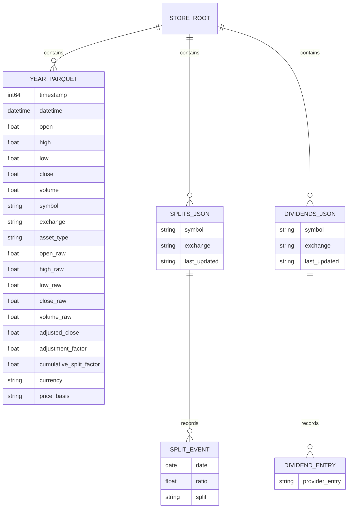
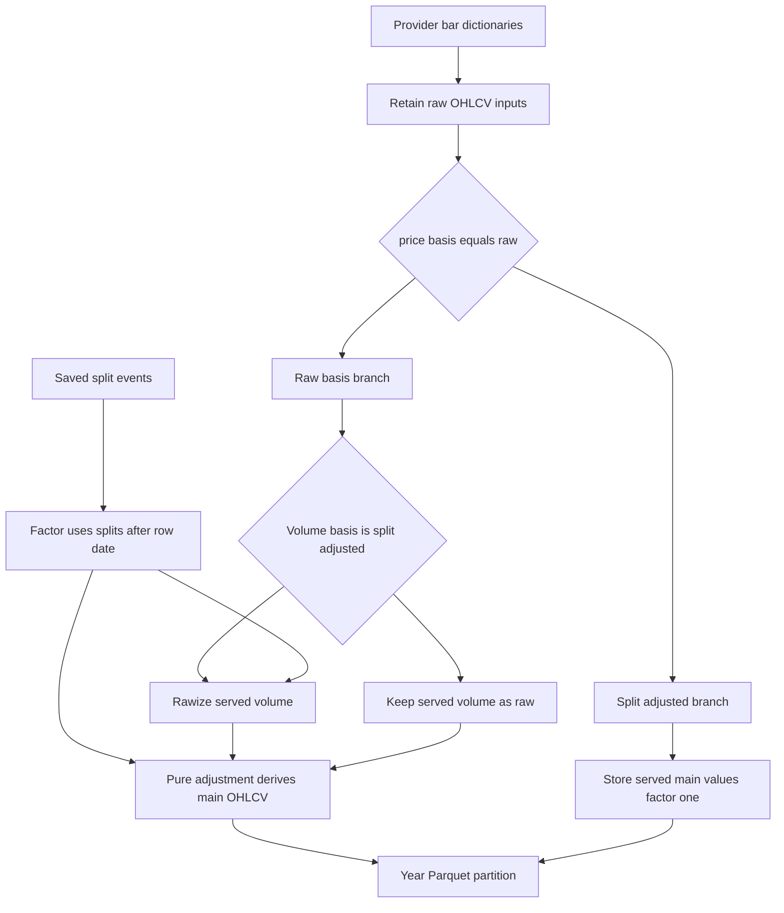

# EOD Data Model, Persistence, and Adjustment

`jef.data` maintains an auditable local EOD store, not merely a model-ready price series. Its central safety rule is simple: **the stored main OHLCV values may be regenerated, but split adjustment never edits its raw inputs.** That permits a late split or a provider correction to be incorporated without repeatedly scaling history.

This page describes the representation and its invariants. For package ownership and external handoffs, see [Data Layer Boundaries and Public Surfaces](../architecture/data-layer-boundaries.md). The configured daily order and tail-refresh policy are detailed in [Universe Sync and Reconciliation](../workflows/universe-sync-and-reconciliation.md).

## The seven-column interchange contract

The seam-facing EOD frame has these seven required columns, in this spelling:

| Column | Meaning at the interchange boundary |
| --- | --- |
| `Date` | Session date, parseable as a date. |
| `Open`, `High`, `Low`, `Close` | Numeric OHLC values. |
| `Adj Close` | The provider's adjusted close, retained separately from the split-only main close. |
| `Volume` | Numeric volume. |

`jef.data.contract.validate()` returns a `ContractReport` rather than raising. Missing required columns, non-numeric price or volume values, duplicate parseable dates, negative prices or volume, and `High < Low` are **errors**. An error means the binning path must not proceed. `validate_or_raise()` is the convenience wrapper for callers that require an exception.

Other observations are deliberately **notes**, not automatic rejection: dates out of order will be sorted by the load transform; unparseable dates, zero-volume rows, and rows containing `NaN` will be dropped there; extra columns are carried through and their nulls can therefore also cause a drop. The default minimum of `1115` clean rows is advisory, calculated as 720 warm-up rows plus 30 and 365 forward lags. In particular, the validator checks that prices are non-negative; it does not impose a positive-price rule.

The contract is a representation and validation boundary, not the Parquet schema. `ParquetStore.to_contract_frame()` exports stored rows back to these seven fields using split-adjusted main OHLCV values and `adjusted_close` for `Adj Close`. `jef-data export` writes that frame and then prints the contract report. Conversely, `ingest_yahoo_csv()` checks that the seven columns are present but intentionally retains zero-volume rows: row-dropping policy belongs to the downstream seam, not to persistence.

## Persisted entities and their meanings

A store root contains two separate persistence families:

- **Market bars** are year-partitioned Parquet files at `market_data/exchange={exchange}/symbol={symbol}/year={year}/data.parquet`.
- **Corporate actions** are per-symbol JSON files at `corporate_actions/splits/{symbol}.json` and `corporate_actions/dividends/{symbol}.json`. A slash in a symbol is replaced by `_` in the filename.



*Persisted bar partitions carry both derived and raw values, while action files use a separate per-symbol JSON envelope.*

### Bar schema: identity, audit values, and derived values

Each Parquet row carries `timestamp` (Unix milliseconds) and a UTC-aware `datetime`, store identity (`symbol`, `exchange`), classification (`asset_type`, `asset_subtype`), and `currency`. It stores three conceptually different value sets:

1. **Main OHLCV** — `open`, `high`, `low`, `close`, and `volume` are the model-facing values. For a raw-basis series they are split-derived values.
2. **Provider/audit values** — `open_raw` through `volume_raw` are the adjustment inputs; `adjusted_close` is the provider's splits-and-dividends adjusted close; and `adjustment_factor` is `adjusted_close / close_raw`. The latter is an audit measurement, not the split factor used by this store's adjustment pass.
3. **Store-derived split state** — `cumulative_split_factor` records the split-only factor that produced main values, and `price_basis` identifies whether a series is `raw` or `split_adjusted`.

“Immutable raw” means immutable with respect to adjustment: `adjust()` reads `*_raw` and never writes them. It does **not** mean that a provider correction can never be recorded. A tail reconciliation can replace raw values for a re-fetched timestamp when the provider has revised the served bar; once landed, a re-derivation again uses those values as its source of truth.

### Corporate-actions JSON

A split file stores an envelope containing `symbol`, `exchange`, `last_updated`, and a date-sorted `splits` array. Each split has the original `split` string and numeric `ratio`; `ratio` is new shares divided by old shares, so `4/1` is `4.0`. A split event's date is the first session at the new price basis.

Dividend files use the same envelope with a `dividends` list containing provider entries. They are retained from acquisition onward but are **never applied** by split adjustment. An absent action file has a meaningful value: it loads as an empty list, or “no known actions,” rather than requiring a network lookup.

## Raw versus split-adjusted basis

The basis controls whether the CRSP-style split pass is applicable:

| `price_basis` | Ingest and adjustment rule |
| --- | --- |
| `raw` | Raw provider OHLCV is retained in `*_raw`; main fields are derived from those raw values plus known splits. |
| `split_adjusted` | Provider-served values are stored as the main and raw values, `cumulative_split_factor` is `1.0`, and the split pass must not run. |

The sync path derives this choice from the declared asset class, not a ticker heuristic: declared crypto is pre-adjusted, while non-crypto EODHD legs use the raw basis. Yahoo CSV import is explicitly `split_adjusted`; Binance is likewise stored as split-adjusted crypto. Applying a split event to an already adjusted series would double-adjust it, so `adjust()` rejects any input whose `price_basis` contains a value other than `raw` and also refuses a frame missing its raw sources or date column.

There is a provider-specific volume subtlety. EODHD declares its prices raw but its served volume split-adjusted. For a raw-basis ingest, the store first divides served volume by the contemporaneous split factor to create a genuinely raw `volume_raw`, then the normal derivation multiplies it back. Therefore splits must be synchronized **before the first raw-basis load** of a symbol with split history; a later split synchronization can repair values through the same re-derivation path.

## Split-only adjustment is a pure re-derivation

For a row on date `d`, the cumulative factor is the product of ratios for split events strictly **after** `d`:

```text
factor(d) = product(split.ratio for split where d is before split.date)
price_main(d) = price_raw(d) / factor(d)
volume_main(d) = volume_raw(d) * factor(d)
```

The strict effective-date rule matters: a bar dated **on** a split's effective date already trades on the new basis, so that split contributes no factor to that row. A bar before all events receives the product of all later ratios. Invalid non-finite or non-positive ratios are rejected. Dividends and the provider `adjustment_factor` do not enter either formula.



*Raw-basis bars and saved splits meet only in a pure derivation; pre-adjusted bars bypass that path.*

`adjust(df, splits)` copies its input, recalculates the main fields and `cumulative_split_factor`, and carries every other column forward. It is consequently a fixed point for unchanged raw inputs and split events: applying it again produces the same frame rather than compounding a prior adjustment. `ParquetStore.reapply_adjustment()` makes this operational: it loads the whole symbol, derives it again, and writes only when the new frame is different. It is both the normal response to a late split and the repair mechanism when derived columns are suspect but the raw audit trail remains intact.

Use the offline repair entry point when appropriate:

```text
jef-data adjust --exchange eodhd --symbol AAPL.US --store data
```

It loads stored splits and re-derives; it does not fetch actions or bars. A refusal on a `split_adjusted` series is protective, not a request to force the command.

## Reconciliation: revision identity differs from append identity

`save(..., mode="append")` is conservative: it concatenates existing rows before incoming rows, normalizes by timestamp with first-wins semantics, and rewrites only years present in the incoming frame. A duplicate timestamp therefore keeps the stored row.

The daily sync path intentionally uses `reconcile_bars()` instead. For the bars handed to it, it compares exactly this as-served identity:

```text
open_raw, high_raw, low_raw, close_raw, volume_raw, adjusted_close
```

If any one differs at an existing timestamp, reconciliation replaces that row and returns a per-cell revision record with date, column, stored value, and served value. Identical rows are retained; when the supplied frame introduces neither revisions nor new timestamps, reconciliation writes no file. New timestamps append, and dates absent from the supplied window are untouched. The runner, rather than the store method, establishes the normal tail policy by fetching the newest configured sessions (default 10). Thus “newest wins” is limited to the fetched tail, while older history remains frozen-first-seen.

After a raw-basis reconciliation, sync re-applies adjustment to the complete stored series. This sequence means a new split affects all relevant history from raw inputs, while a changed provider row is compared before derived main fields can create a false revision.

## Durability and concurrency invariants

### Parquet writes: serialized per symbol and atomic per year

Every mutating Parquet operation holds a POSIX `fcntl.flock` on `{symbol_dir}/.lock` across its read-modify-write cycle. Acquisition waits in 0.5-second intervals up to the configured `lock_timeout` (300 seconds by default) and then raises `StoreError`; a stuck writer is surfaced rather than silently queued forever. Readers do not acquire this lock.

Each target year is written to `data.parquet.tmp` and then installed with `os.replace()`. This makes an individual year replacement atomic to lock-free readers; a leftover temporary file is ignored by `load()` and cleaned as writer hygiene. Overwrite mode writes all new target files before deleting stale year partitions, so it avoids a delete-first gap where history exists only in memory. Append mode bounds rewrites to incoming years.

These guarantees are deliberately scoped. A symbol contains multiple files, so there is no all-years transaction: a failure between year replacements can leave a readable store with a mixture of old and new partitions. The next idempotent re-derivation can converge it. The implementation also does not add an `fsync` protocol; do not describe per-year `os.replace()` as a whole-store or power-loss transaction.

### Corporate-actions JSON is intentionally less durable

Corporate-action saves use `open(path, "w")` followed by `json.dump()` directly. They do not use the Parquet temp-and-replace path or its per-symbol writer lock. This is an intentional difference in current behavior, not a reason to infer that all state below one store root has the same crash or concurrency properties.

> **Operational implication:** when strengthening durability or adding concurrent writers, assess the Parquet and action stores separately. Making Parquet year files atomic does not make a simultaneous action JSON update atomic, coordinated, or recoverable as one transaction.

## Entry points, operations, and safe changes

The focused commands expose the lifecycle without changing its invariants:

| Entry point | Use and behavior |
| --- | --- |
| `jef-data validate CSV` | Report seven-column contract errors and notes without importing Parquet or HTTP components. |
| `jef-data sync-actions --symbol SYMBOL` | Fetch and persist that symbol's split and dividend JSON. Run before an initial raw EODHD load. |
| `jef-data load` | Manual incremental EODHD ingestion; raw-basis series are re-derived after loading. |
| `jef-data sync` | Normal configured batch path: actions are refreshed before raw EODHD bars, then the fetched tail is reconciled and re-derived. |
| `jef-data adjust` | Offline, idempotent re-derivation from persisted `*_raw` and stored splits. |
| `jef-data import-csv` / `jef-data export` | Import a Yahoo-format pre-adjusted series or render the seven-column interchange frame. |

For health signals that use the persisted state—such as missed sessions, action freshness, and a split-shaped jump without a same-day action—see [Store Health and Alerts](../operations/store-health-and-alerts.md). Provider normalization and volume-basis declarations are described in [Market Data Collectors](../integrations/market-data-collectors.md).

When changing this subsystem, preserve these focused verification properties:

1. Test the validator's error/note split separately from persistence. Include duplicate dates, `High < Low`, unsorted dates, zero volume, and null/extra-column behavior.
2. Use rows before, on, and after a split effective date to prove strict-after factor selection. Verify price division, volume multiplication, and rejection of degenerate ratios.
3. Assert `adjust(adjust(frame, splits), splits)` equals one adjustment and that raw columns remain unchanged; separately assert that non-raw `price_basis` is refused.
4. Test both duplicate contracts: append keeps the existing row, while reconciliation records and replaces a changed served-identity cell only in the supplied window.
5. Test lock timeout and a leftover `.tmp` file, and simulate failure boundaries across multiple year partitions. Do not test only the happy path of an atomic-looking single-year replacement.
6. Test action JSON persistence independently from Parquet durability, including missing-file-as-empty semantics and action refresh before raw EODHD volume rawization.

The relevant substitution and replay seams are covered in [Verification and Replay Seams](../testing/verification-and-replay-seams.md). Basis selection is tied to the declared universe class; changes to that classification should be evaluated with [Universe and Classification](universe-and-classification.md), not by adding a ticker-suffix inference rule.
