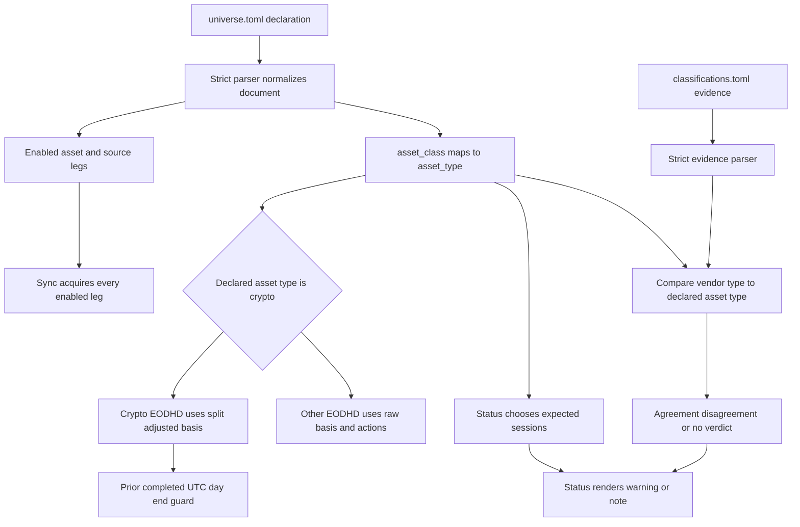

# Universe Declarations and Classification Evidence

`jef.data` deliberately separates two questions that may look similar:

1. **What should the system acquire and how should it treat it?** `src/jef/data/universe.toml` answers this declaratively. Its `asset_class` is authoritative configuration.
2. **Does recorded vendor metadata agree with that declaration?** `src/jef/data/classifications.toml` answers this as evidence. It can produce a warning, but it never selects a class, rewrites the universe, or changes an ingestion decision.

This boundary is important because classification is operational, not descriptive. The declared class is converted into the store `asset_type` and drives price treatment, corporate-action eligibility, calendar expectations, and the guard against treating an in-progress crypto day as complete. Vendor evidence is intentionally a separate, offline check of that decision.

For store representation and split re-derivation, see [EOD Data Model, Persistence, and Adjustment](eod-data-model-and-adjustment.md). For the batch lifecycle, see [Universe Sync and Reconciliation](../workflows/universe-sync-and-reconciliation.md); its operational consequences are covered by [Store Health and Alerts](../operations/store-health-and-alerts.md).

## Two files, two authorities

| File | Role | May control acquisition? | May report disagreement? |
| --- | --- | ---: | ---: |
| [`src/jef/data/universe.toml`](../../src/jef/data/universe.toml) | The selected assets, source legs, and declared classes. | Yes | Not by itself |
| [`src/jef/data/classifications.toml`](../../src/jef/data/classifications.toml) | Committed EODHD classification evidence keyed by store identity. | No | Yes |

The packaged universe defaults the store root to `data` and currency to `USD`. At the current revision it declares AAPL, BTC, TLT, NVDA, TSLA, and IBM. AAPL and BTC have a modeled EODHD source plus additional snapshot or cross-check sources; the other listed equities/ETF have an EODHD modeled source. Run `jef-data universe` to render the normalized declaration rather than hand-interpreting TOML defaults.

The configured source identity is the pair `(exchange, symbol)`, where `exchange` is a store partition tag rather than a listing exchange. Default tags are `eodhd`, `binance`, and `yahoo`; an EODHD listing exchange remains part of a canonical symbol such as `AAPL.US` or `BTC-USD.CC`.

## Universe shape and normalization

[`load_universe()`](../../src/jef/data/universe.py) is the only parser. With no path it reads the packaged `universe.toml`; `--universe PATH` makes `jef-data sync`, `status`, and `universe` load an explicit file. It returns one normalized document with `defaults` and `assets`, so downstream selection works from resolved values rather than conditionally interpreting raw TOML.

| Level | Supported fields | Normalization or meaning |
| --- | --- | --- |
| `[defaults]` | `store`, `currency` | Defaults to `data` and `USD`. |
| `[[asset]]` | `name`, `asset_class`, `currency`, `threshold`, `enabled`, `[[asset.source]]` | Produces an `asset_type`, resolved currency, float threshold, enabled flag, and source list. |
| `[[asset.source]]` | `provider`, `symbol`, `path`, `exchange`, `start`, `end`, `kind`, `enabled`, `modeled`, `note` | Produces a provider-specific store coordinate, source currency, and normalized ISO dates. |

Only `eodhd`, `binance`, and `yahoo-csv` providers are accepted, and `kind` may only be `eod`. EODHD symbols must already be canonical `TICKER.EXCHANGE` identifiers. A `yahoo-csv` source requires `path` and cannot have `start` or `end`; collector sources cannot have `path`, and their optional ISO `start` must not follow `end`.

### Intentionally not tuning knobs

The parser rejects unknown keys at the top, defaults, asset, and source levels. This is a safety mechanism: a misspelled control cannot silently cause an asset or source to be skipped.

Some fields are deliberately constrained or informational:

- `price_basis` and `volume_basis` are **not** universe fields. They are derived by the ingestion path, so an unsafe raw/pre-adjusted combination cannot be configured casually.
- `threshold` must be numeric and is carried in the normalized asset for display, but does not control acquisition or loader behavior.
- A non-EOD `kind` is rejected rather than treated as an alternate mode. Supporting intraday or another cadence would require a new downstream contract.

## Declaration invariants and modeled-source choice

A syntactically valid TOML document is not enough. The parser raises `UniverseError` with the offending location for these conditions:

- missing required names, class, providers, symbols, or source tables;
- unsupported provider, class, or `kind`, non-boolean flags, invalid dates, or invalid path/date combinations;
- duplicate asset names or a store coordinate claimed by more than one asset;
- an enabled asset with no enabled source;
- a disabled source marked `modeled = true`, or more than one enabled modeled source; and
- an enabled asset with multiple enabled sources but no explicit modeled source.

The last rules make the model feeder deterministic. For an enabled asset with one enabled source, that sole source is implicitly the modeled source. For multiple enabled sources, exactly one must carry `modeled = true`. [`modeled_source(universe, name)`](../../src/jef/data/universe.py) returns that `(asset, source)` pair and rejects an unknown or disabled asset.

This is not a request to acquire only the modeled series. [`select_legs()`](../../src/jef/data/sync.py) returns **every enabled source** of every selected enabled asset; the additional legs remain available for redundancy and comparison. The modeled marker identifies the intended binning feeder, while the sync runner acquires the complete enabled declaration.



*The declaration drives acquisition decisions; the independently recorded evidence joins only at the read-only status check.*

## What the declared class decides

The configuration vocabulary and its store vocabulary are intentionally small:

| `asset_class` | Derived `asset_type` | Calendar family |
| --- | --- | --- |
| `stock` | `stock` | Weekdays |
| `bond_etf` | `etf` | Weekdays |
| `crypto` | `crypto` | Every calendar day |

The class is declared once per asset, then copied into each selected leg. That single value has the following concrete consequences.

| Decision | Rule | Consequence of a wrong declaration |
| --- | --- | --- |
| **Stored asset type** | `select_legs()` passes the derived `asset_type` to every store ingest. | Stored classification and consumers of it are wrong. |
| **EODHD price basis** | Declared crypto uses `split_adjusted`; any other declared class uses `raw`. | A crypto series could be run through the split-adjustment path, or a raw series could skip it. |
| **Corporate-action eligibility** | Only EODHD legs whose declared type is not `crypto` refresh splits and dividends before loading bars. | The action workflow would be applied or omitted on the wrong basis. |
| **Calendar expectations** | `stock` and `etf` expect weekday sessions; types outside that set expect every day. | Staleness and post-seam-gap measurements use the wrong expected-session count. |
| **Crypto end guard** | A declared crypto leg ends no later than the prior completed UTC day. The configured `end`, when present, is combined using the earlier date. | An in-progress daily bar can be stored as a completed observation, or valid crypto history can be needlessly excluded. |

The first three class-dependent choices are specific to EODHD behavior. Binance legs are always stored with `price_basis="split_adjusted"`; `yahoo-csv` imports are also split-adjusted. Their class is still persisted as `asset_type` and used by health-calendar logic.

Do not replace this declaration with a ticker heuristic. The manual `jef-data load` path requires `--asset-type` unless an EODHD `.CC` symbol itself establishes the crypto namespace, and it refuses a `.CC` symbol declared non-crypto. That is a narrower safeguard for one-off loading, not an alternative source of truth for the universe.

## Selection and acquisition lifecycle

`jef-data sync` loads the universe, rejects unknown `--asset` or `--provider` filters, and rejects a filter combination that selects no enabled legs. A source or its parent asset with `enabled = false` does not become a leg.

For collector legs, the fetch window has two deliberately different bounds:

- `start` is a **first-fill floor**. Once a series exists, sync re-fetches the oldest of the most recent `tail` stored sessions; the default tail is 10 and `tail` must be at least 1.
- `end` is a **persistent cap** on both first fills and tail refreshes. If an existing tail starts after that cap, the runner reports a loud no-fetch plan rather than sending an inverted request.
- A crypto guard is an additional end cap, not a replacement for the configured `end`.

A `yahoo-csv` leg imports its whole file idempotently. A collector leg fetches and reconciles its window; for raw EODHD legs, action refresh happens before bars, then the complete stored series is re-derived from raw fields and current splits. A failed leg is contained so later legs can run and be reported, but the aggregate sync result is unsuccessful and the CLI exits nonzero. `--dry-run` plans from local state without constructing collectors, so it does not require a provider key or network access.

```text
jef-data universe
jef-data sync --dry-run
jef-data sync --universe path/to/universe.toml --asset BTC --provider eodhd
jef-data status --universe path/to/universe.toml --json
```

`status` is read-only and filters `yahoo-csv` legs out of live-source health checks. The full daily command chain and publication gate are described in [the quickstart](../quickstart.md) and [market-data collector integration](../integrations/market-data-collectors.md).

### Class corrections require a data migration decision

Changing `asset_class` is not a cosmetic metadata edit. In particular, tail reconciliation determines replacement only from provider-served raw fields and `adjusted_close`. If those values are unchanged, it retains existing stored rows; it does not compare `asset_type` or `price_basis` merely because the declaration changed. Therefore a class correction for an already populated series needs an explicit review and rebuild or migration plan rather than reliance on an ordinary tail refresh.

## Committed vendor classification evidence

[`load_classifications()`](../../src/jef/data/classification.py) separately parses `classifications.toml` with an independent strict schema. It requires `schema = 1`, rejects unknown top-level and instrument fields, validates `last_verified` if present, and rejects duplicate `(exchange, symbol)` entries. Each evidence entry has required `exchange`, `symbol`, `code`, `query_exchange`, and `vendor_type`; `isin`, `name`, and verification date provide recorded context.

The lookup key is the **store identity** `(exchange, symbol)`. `code` and `query_exchange` record the vendor query that generated the result; they are not alternate lookup keys. The checker reads the packaged committed file—there is no vendor network call in the status path. A malformed evidence document raises `ClassificationError` instead of silently degrading into “no evidence.”

The comparison is deliberately narrow:

| Evidence condition | Verdict | Status treatment |
| --- | --- | --- |
| No record for the EODHD store coordinate | `no_evidence` | Note |
| Vendor type is `Currency` | `not_comparable` | Note |
| Vendor type has no mapping to the store vocabulary | `unmapped` | Note |
| `Common Stock` maps to `stock`, or `ETF` maps to `etf`, and matches the declaration | `agree` | Note |
| A mapped vendor type resolves to a different store type | `disagree` | **Warning** |

`Currency` is intentionally not treated as crypto confirmation: the evidence code considers it ambiguous because EODHD can use that vendor type for both crypto and forex namespaces. Likewise, unrecognized vendor types are not guessed into a class. A non-disagreement verdict means only that the evidence cannot identify a conflict; it is not a second authoritative classification.

During `check_source()`, the evidence comparison runs only for EODHD legs. The report receives `declared_class_check`; `disagree` appends a warning and every other verdict appends a note. `jef-data status` includes warning totals in its JSON envelope and table output, but returns exit status 1 only when there are alerts. Thus a classification mismatch is deliberately conspicuous without blocking the daily publication chain on metadata alone.

## Safe extension and verification checklist

Treat a new class or provider as a cross-cutting contract change, not as a TOML-only addition.

1. **Add vocabulary deliberately.** Extend `ASSET_TYPE_BY_CLASS`, preserve strict parser validation, and decide whether the new store type has weekday or every-day calendar expectations.
2. **Make all class-derived policy explicit.** The current EODHD logic is a crypto versus non-crypto split for price basis, action refresh, and end guarding. Specify the new class in each policy rather than allowing it to fall through accidentally.
3. **Do not invent evidence mappings.** Add an EODHD vendor-type mapping only when the type maps unambiguously to a representable store type. Otherwise preserve `unmapped` or `not_comparable` behavior.
4. **Implement a provider end to end.** A provider needs parser vocabulary and exchange defaults, collector construction, a normalized bar shape and volume-basis declaration, plus an explicit raw versus split-adjusted ingest policy.
5. **Test the negative paths.** Exercise unknown keys, duplicate coordinates, bad source bounds, invalid filtered selection, an enabled multi-source asset with no modeled marker, and an enabled asset with no live source. For classification, test all five verdicts and prove that only `disagree` becomes a warning.
6. **Test policy and state transitions.** Verify the declared class drives all five decisions in the table above, the crypto guard combines correctly with a configured `end`, and a declaration-only class change does not masquerade as a completed persisted-data migration.

These checks keep the central boundary intact: `universe.toml` controls what the system does; `classifications.toml` supplies auditable evidence about whether that declaration deserves review.
