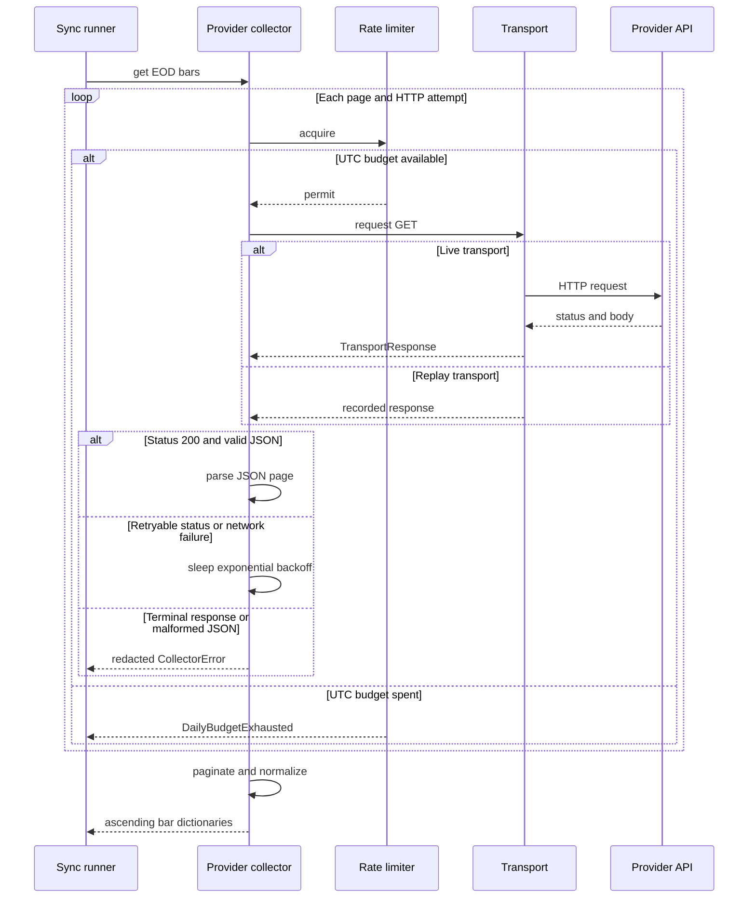

# Market-Data Collector Integrations

`jef.data.collectors` is the boundary between provider protocols and the local EOD store. A provider adapter obtains provider-shaped JSON and returns ascending EOD bar dictionaries; it does **not** decide the store's partition layout, adjustment formula, reconciliation window, or model input policy. Those decisions belong to the store and the configured sync runner. This separation makes the HTTP behavior replaceable while keeping the ingestion contract explicit.

The normal batch entry point is `jef-data sync`. It resolves configured EODHD, Binance, and `yahoo-csv` legs, then hands collector bars to store reconciliation. For persistence and raw-versus-adjusted storage rules, see [EOD Data Model, Persistence, and Adjustment](../concepts/eod-data-model-and-adjustment.md). For selection, class-derived basis policy, and daily windows, see [Universe Declarations and Classification Evidence](../concepts/universe-and-classification.md) and [Universe Sync and Reconciliation](../workflows/universe-sync-and-reconciliation.md).

## Integration boundary and normalized bars

Every HTTP collector derives from `BaseCollector` and sends requests through a transport with this small protocol:

```text
request(method, url, params) -> TransportResponse
```

`TransportResponse` carries an HTTP status and text body and supplies JSON decoding. `BaseCollector`, rather than a concrete transport, owns the rate budget and retry loop. Consequently, the same policy applies to a live `HttpTransport`, a fixture-backed `ReplayTransport`, and a `RecordingTransport` wrapper. The production transport creates a `requests.Session` lazily when constructed, so merely importing the collectors does not import `requests`.

A successful provider fetch is expected to yield EOD bar dictionaries with these store-facing values:

| Value | Collector/store boundary meaning |
| --- | --- |
| `date` | ISO `YYYY-MM-DD` session or UTC-day date. |
| `open`, `high`, `low`, `close`, `volume` | Numeric OHLCV values as served or normalized by the provider adapter. |
| `adjusted_close` | Provider split-and-dividend-adjusted close when supplied; the store falls back to `close` if it is absent. It is an audit value, not the store's split-only main close. |

This is a deliberately modest normalization contract, not a claim that values are economically interchangeable across feeds. In particular, the volume field retains each provider's unit and basis. The store must be passed both `price_basis` and the collector's `VOLUME_BASIS` so it can apply the correct storage treatment.



*Each transport attempt consumes the shared collector budget; successful pages are then provider-normalized before the sync runner receives bars.*

The runner passes those bars to `ParquetStore.reconcile_bars()` together with the declared asset type, currency, price basis, and volume basis. For an established series, sync normally re-fetches a bounded recent tail and accepts revisions only inside that supplied window; that is intentionally different from the manual append path. A raw EODHD leg obtains corporate actions before its bars and re-derives the stored series afterwards. A declared crypto EODHD leg, Binance, and Yahoo CSV are stored on the pre-adjusted path instead.

## Shared HTTP policy

### Rate limiter: two independent limits

`RateLimiter` has a sliding 60-second request window and a separate hard budget for the current UTC date. Its defaults are `per_minute=1000` and `daily_budget=100_000` per collector instance.

- `acquire()` first resets the daily count when the UTC date changes. If the count has reached the daily budget, it raises `DailyBudgetExhausted`; it does not sleep until tomorrow or borrow quota from another day.
- Otherwise it removes timestamps at least 60 seconds old. When the minute window is full, it sleeps until the oldest entry exits the window, then records the new request and increments the daily count.
- The limiter is called before **every attempt**, not merely every logical page. A retry, a failed network call that reached the transport, and a replayed call all consume an acquire slot.

The limiter's clock, sleeper, and UTC-date function are injectable. That is intentional: rate-boundary tests can advance deterministic time rather than wait a real minute or day.

`run_sync()` constructs and caches at most one non-injected collector per selected provider for a run. Therefore its EODHD rate limiter is shared by that run's EOD bars, split calls, and dividend calls across EODHD legs; the Binance limiter is shared by its Binance legs. There are no universe TOML fields that tune these budgets. An operator or integration that needs different limits must construct or inject a collector with an appropriate `RateLimiter`, rather than encode a provider quota as an unrelated acquisition window.

### Retries and terminal failures

`BaseCollector.get_json()` performs at most `max_retries + 1` attempts. The defaults are four retries and a 2.0-second backoff, yielding sleeps of 2, 4, 8, and 16 seconds before the remaining attempts.

| Outcome | Behavior |
| --- | --- |
| `TransportConnectionError` | Retry until attempts are exhausted, then raise `CollectorError`. The real transport converts `requests` connection and timeout exceptions into this retryable type. |
| HTTP `429` or any `5xx` | Retry on the same schedule; exhaustion raises `CollectorError` naming the status and attempt count. |
| Other non-`200` HTTP status | Fail immediately as `CollectorError`; the message includes at most 200 body characters after secret redaction. |
| HTTP `200` with invalid JSON | Fail immediately as a redacted `CollectorError`. |
| `DailyBudgetExhausted` | Propagates immediately from the limiter; it is a quota condition, not a retryable HTTP result. |

This policy intentionally does not turn every exception into a retry. For example, only connection and timeout exceptions receive the real transport's retryable wrapper. A provider adapter also checks its own expected JSON shape and raises `CollectorError` for a structurally wrong response.

### Pagination guard

`BaseCollector.paginate(fetch_page, cursor, max_pages=100)` is an ascending-cursor helper. The callback returns `(rows, next_cursor)`; pages are accumulated until `next_cursor is None`. Reaching the cap raises rather than silently returning a truncated history. EODHD's EOD implementation makes one date-bounded endpoint request and does not use this helper. Binance uses it for daily kline history.

## EODHD

### Credentials and requests

`EODHDCollector` requires an API key supplied as `api_key=` or through `EODHD_API_KEY`. Absence is rejected before constructing its parent and therefore before a default HTTP session can be opened. Each EODHD request adds the key only as the `api_token` request parameter and adds `fmt=json`.

Its public methods cover four provider operations:

| Method | EODHD request and result policy |
| --- | --- |
| `get_eod(symbol, start, end, period)` | Calls `/eod/{symbol}` with JSON, ascending `order=a`, default daily `period=d`, and optional `from`/`to`. It drops non-positive closes, deduplicates by date with the first row winning, then returns date-sorted rows. |
| `get_splits(symbol, start, end)` | Calls `/splits/{symbol}`, turns provider entries into `SplitEvent` values, and sorts them by effective date. |
| `get_dividends(symbol, start, end)` | Calls `/div/{symbol}` and returns date-sorted provider entries. These entries are retained by the actions store but are not applied by split adjustment. |
| `search(query, exchange)` | Calls `/search/{query}`. A friendly exchange name is translated through `EXCHANGE_MAP` when known. |

`normalize_symbol()` makes EODHD symbology explicit. A dotted identifier passes through, a bare ticker receives `.US`, a fiat pair such as `EUR/USD` becomes `EURUSD.FOREX`, and a pair with a recognized crypto quote such as `BTC/USD` becomes `BTC-USD.CC`. A pair that fits neither rule is refused rather than guessed. The universe parser is stricter for configured EODHD legs: it requires their symbols to already include an exchange suffix.

### Basis and volume semantics

EODHD's collector declares `VOLUME_BASIS = "split_adjusted"`. Its EOD price fields are treated as raw for a non-crypto EODHD series, while provider `adjusted_close` is preserved only as an audit value. When such a raw-basis series is ingested, the store divides served volume by the contemporaneous cumulative split factor to make `volume_raw` genuinely raw, then obtains model-facing main OHLCV through its split-only derivation. This makes action synchronization before a first raw EODHD load load-bearing for symbols with split history.

The provider's basis declaration alone does not decide `price_basis`. The sync runner derives that from the declared asset type: declared EODHD crypto is `split_adjusted` and bypasses the CRSP-style adjustment pass; other EODHD classes are `raw` and use actions. For a pre-adjusted series, the EODHD volume-basis distinction is not consulted by the store. Do not infer this decision from `.CC` within a new integration; the universe declaration is the operational source of truth.

## Binance daily klines

`BinanceCollector` is a deliberately narrow public integration: it calls `GET /api/v3/klines` with `interval=1d`, a symbol, and a page `limit` that defaults to 1000. It needs no API key. It converts kline arrays into the common bar dictionaries, using the open timestamp as a UTC ISO date, setting `adjusted_close` equal to `close`, and converting OHLCV fields to floats. Bars with a non-positive close are discarded; duplicate dates retain the first result and final output is date-sorted.

Binance pagination is ascending. A supplied `start` is converted to a UTC millisecond `startTime`; `end` is made inclusive through the final millisecond of its UTC date. A full page advances to the last open time plus one day. Pagination ends on a short page or when the end bound has been reached, and is also protected by the shared 100-page cap.

A first Binance request with no configured start omits `startTime`. The packaged BTC Binance source explicitly supplies `start = 2017-08-01` so an initial fill requests history rather than relying on the endpoint's default slice. After a store series exists, the sync tail window—not this original floor—sets the routine start date; a configured `end` remains a cap on every fetch.

Binance daily crypto has no corporate-action split path and sync stores it as `price_basis="split_adjusted"`. Its `volume` is **base-asset volume**—for example BTC for `BTCUSDT`. EODHD and Yahoo use notional-volume semantics in the configured comparison context. Per-series volume ratios may remain useful inside their own series, but base-asset and notional volumes are not directly comparable across providers. Never use a cross-provider volume match as a price-feed equivalence test; use the differential and health paths with that unit distinction in mind.

## Committed Yahoo CSV ingestion

`yahoo-csv` is intentionally not an HTTP collector. It is an offline source leg whose universe declaration requires a local `path`, forbids collector `start` and `end` bounds, and normally uses the `yahoo` store partition. During sync, the entire CSV is read and passed to `ParquetStore.ingest_yahoo_csv()`; no provider transport, credential, retry policy, or live Yahoo request is involved.

The importer requires the seven CSV headings:

```text
Date, Open, High, Low, Close, Adj Close, Volume
```

It maps these rows to bar dictionaries, retains `Adj Close` as `adjusted_close`, and imports with `price_basis="split_adjusted"` and overwrite mode by default. `Close` and `Volume` are therefore treated as already split-adjusted provider values, `cumulative_split_factor` is one, and future split reapplication is refused. The importer does not proactively filter rows: it passes even zero-volume rows to persistence, while an invalid value may still make conversion fail. Zero-volume or null-dropping policy belongs to the downstream seven-column seam, not this importer.

The whole-file overwrite makes an unchanged snapshot semantically idempotent and prevents an import from being an incremental network feed. It also means a changed CSV replaces the configured symbol's store series rather than reconciling only a tail. `jef-data status` excludes `yahoo-csv` legs from live-source health checks for the same reason: a committed snapshot is not evidence of a current feed.

## Secrets, recording, and replay

The secret boundary is intentionally narrow and testable:

- `SECRET_PARAMS` currently contains only `api_token`. `request_key()` uses the uppercased method, URL **path**, and sorted public parameters converted to strings; secret parameters are omitted from this identity.
- `HttpTransport` redacts the configured secret parameter value when it reports a connection or timeout failure. `BaseCollector` also redacts values a subclass registered in `_secrets` from terminal response and JSON-decode errors. EODHD registers its API key there.
- `ReplayTransport(fixture_dir)` recursively loads JSON fixtures except `manifest.json`, records public request keys in `calls`, and raises loudly when a request has no recorded identity. A replay request returns the recorded status and JSON response body, but still runs through the collector's limiter and retry/error logic.
- `RecordingTransport(inner, fixture_dir, secrets=())` forwards the real request, serializes a public request identity plus `{status, json}` response, and names the file from a hash of that identity. Before writing, it refuses a serialized fixture containing any nonempty value provided in `secrets`.

The safety boundary for recording is important: request identity always removes `api_token`, but response scanning protects only the secret values supplied to `RecordingTransport`. A recording caller should pass the active EODHD key and should treat a refusal as a successful secret-leak prevention event, not as permission to manually edit and commit the response. Conversely, `ReplayTransport` is intentionally strict: an unrecorded request is a test or fixture-coverage failure, not a reason to reach the network.

Fixtures encode parsed JSON, not arbitrary raw wire bodies. They are appropriate for deterministic provider payload, pagination, response-status, and normalized-output tests. To test a malformed live JSON body, use a small injected transport that returns a `TransportResponse` with malformed text rather than trying to produce that case through `RecordingTransport`.

## Operations and safe extension

### Running configured sources

The normal configuration lives in [`src/jef/data/universe.toml`](../../src/jef/data/universe.toml). It keeps separate store series for the providers so an EODHD modeled feed, Binance redundancy feed, and Yahoo snapshot never overwrite one another. Typical commands are:

```text
jef-data sync --dry-run
jef-data sync --asset AAPL --provider eodhd
jef-data sync --asset BTC --provider binance
jef-data import-csv --csv experiments/AAPL.csv --symbol AAPL --asset-type stock
```

An EODHD run requires `EODHD_API_KEY` unless a collector is injected by Python code. `--dry-run` calculates the local plan without constructing any collector, so it requires neither the key nor network access. In a real run, a failure of one source leg is reported while other selected legs continue; the aggregate run is unsuccessful and the CLI returns nonzero. Check [Store Health and Alerts](../operations/store-health-and-alerts.md) after acquisition rather than treating a successful individual HTTP response as proof of a healthy store.

### Adding a provider safely

Adding an adapter is more than adding a URL. The current universe parser accepts only `eodhd`, `binance`, and `yahoo-csv`, and `run_sync()` knows how to construct only the two HTTP collectors. An end-to-end addition needs all of the following:

1. Add the provider and its default exchange tag to the strict universe vocabulary, then implement collector construction in the sync runner.
2. Return ascending, deduplicated bar dictionaries with the fields the store consumes. Decide how invalid provider rows are rejected or filtered; do not silently invent prices.
3. Declare the provider's `VOLUME_BASIS` and explicitly choose raw or `split_adjusted` price treatment. If it supplies corporate actions, define their lifecycle before attempting a raw-basis initial load.
4. Preserve the `BaseCollector` transport seam so rate limiting, retry behavior, redaction, fixture recording, and offline replay remain available. Do not place a second retry loop in a provider adapter.
5. Specify cursor direction, an inclusive/exclusive bound rule, and a loud page cap for any paginated endpoint. A default trailing page is not history.

### Focused verification

The most valuable tests exercise control boundaries rather than a live key:

1. Use injected clock and sleeper functions to show the minute wait, UTC budget reset, and immediate daily-budget failure. Verify a retry consumes a second budget slot.
2. Use scripted transports for connection failures, `429`, `5xx`, terminal `4xx`, and invalid JSON. Assert the exact attempt ceiling and backoff sequence, and assert that a token never appears in failure text.
3. Record and replay a public request identity. Verify secret query parameters do not change a fixture key, unknown fixture requests fail loudly, and recording rejects a response containing its configured secret.
4. For Binance, use multiple full pages, a final short page, an inclusive end date, duplicate timestamps, and a 100-page overrun. For EODHD, test symbology conversion, wrong JSON shape, duplicate dates, and non-positive close filtering.
5. Feed each provider's bars into store ingestion and assert the basis boundary: raw EODHD volume rawization plus re-derivation, versus factor-one Binance and Yahoo series. Explicitly assert that no test compares Binance base-asset volume directly with EODHD or Yahoo notional volume.
6. Exercise sync with injected collectors and an injected UTC clock: raw EODHD actions precede bars, crypto is prior-day guarded, a CSV-only or dry run needs no collector, and one failed leg makes the overall result red without preventing independent legs from being reported.

These tests use the same seams production uses and avoid credentials, provider availability, and mutable remote history as test dependencies. For the broader replay boundary, see [Verification and Replay Seams](../testing/verification-and-replay-seams.md).
