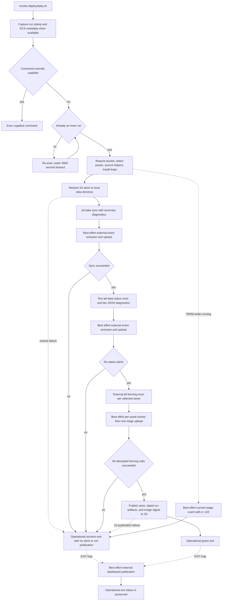

# Daily Run, Telemetry, and Publication Gates

`deploy/daily.sh` is the integration-level daily orchestrator. It restores the local `data/` working copy from S3, runs the repository-owned acquisition and health commands, invokes the model command, and writes the durable store and run artifacts back to S3 **only after all operational gates succeed**. It is ECS-aware—it captures ECS v4 task metadata when available—but it is not the scheduler definition: the script says scheduling belongs to EventBridge infrastructure outside this checkout.

This page describes the deployment control contract, not the EOD data representation. See [Data Layer Boundaries and Public Surfaces](../architecture/data-layer-boundaries.md) for component ownership, [Universe Sync and Reconciliation](../workflows/universe-sync-and-reconciliation.md) for acquisition behavior, and [Store Health and Alerts](store-health-and-alerts.md) for the status predicates.

> **Boundary warning:** `jef-binning`, `python3 -m jef.events`, and `python3 -m jef.dashboard` are deployment-time integrations, not implementations supplied by this repository. `deploy/events.sh` and `deploy/dashboard.sh` are present as given helper code so that the shell chain is readable, but `deploy/EXTERNALS.md` classifies them as external to the subject. The S3 operations, ECS metadata service, and EventBridge schedule are infrastructure boundaries as well.

## Daily control path

The operational pipeline is intentionally narrow: **restore → sync → status → binning → publish**. Failure at any operational step terminates the shell under `set -euo pipefail`; in contrast, event and dashboard work is explicitly designed not to change that result.



*The solid path is operational and controls the task result. Dashed telemetry and dashboard paths may write observability objects on either a green or a red run, but are not success gates.*

### The green-only invariant

The script restores `s3://${JEF_S3_BUCKET}/store/` into `data/` before it starts the stages. An empty bucket is a supported first-run case: the restore sync does no work and acquisition can fill the local store. It then constructs one `--asset` filter for every selected asset and runs these stages in order:

1. `jef-data sync ... --store data --summary-json out/<UTC-date>/.diagnostics/sync.json`;
2. `jef-data status ... --store data --json`, with its one JSON result copied to `out/<UTC-date>/.diagnostics/status.json`; and
3. `jef-binning` once for each asset, with `--counter-start latest --counter-end latest` and an asset-specific output directory under `out/<UTC-date>/`.

Only if each stage has a zero exit status does the shell publish the following operational artifacts:

```text
local data/                 -> s3://<JEF_S3_BUCKET>/store/
local out/<UTC-date>/       -> s3://<JEF_S3_BUCKET>/runs/<UTC-date>/
JEF_IMAGE_DIGEST text       -> s3://<JEF_S3_BUCKET>/runs/<UTC-date>/image_digest.txt
```

A failed sync, a status alert, or a failed binning invocation therefore prevents the final `store/`, `runs/<UTC-date>/`, and digest writes. This is important because sync can complete healthy source legs before reporting an unhealthy one; its aggregate nonzero result stops the daily publish rather than treating a partial local update as a good run.

The gate is **not an atomic S3 transaction**. The three final AWS commands run sequentially under strict shell failure handling. If, for example, the store sync succeeds and the run-artifact sync fails, the store may already be visible while the run is operationally red and the digest upload is not attempted. “Green-only” means publication is attempted only after the three computation gates pass; it does not imply all-or-nothing visibility across S3 prefixes.

### Why status is evaluated once

`status --json` is piped through `tee` rather than executed once for console output and again for an attachment. With `pipefail` enabled, the captured pipeline status still reflects a status failure. More importantly, the attached JSON and the gating decision are one evaluation of time-sensitive freshness checks, rather than two checks made at slightly different instants.

The `jef-data status` command is an offline store-health gate. It evaluates live configured legs, returns 1 when there are alerts, and returns 0 when there are only warnings or notes. This keeps an ordinary cross-venue spread warning and other non-alert observations visible in diagnostics without blocking publication; an operator can opt into promotion for the CLI separately, but the daily script does not pass that option. See [Store Health and Alerts](store-health-and-alerts.md) for the distinction between alerts, warnings, and notes.

## Invocation, provenance, and lifecycle

### ECS entrypoint and command overrides

The no-argument path is the daily workflow. Before installing daily traps, the script has a special argument guard: any argument other than `--inner` is executed with `exec "$@"`. This accommodates ECS command overrides, which arrive as entrypoint arguments rather than replacing the entrypoint; a one-off command does not get swallowed by a full daily run. It does inherit the provenance environment described below.

The normal outer invocation then replaces itself with:

```text
timeout --signal=TERM --kill-after=60 3600 "$0" --inner
```

The inner invocation performs the daily work. The hard cap applies to that inner chain: at 3,600 seconds `timeout` sends `TERM`, then sends a hard kill if the child remains alive for 60 more seconds. This prevents a wedged task from holding its venue lock indefinitely.

The inner shell handles `TERM` by attempting to emit and upload an event for the current `STAGE` with return code `143`, then exits `143`. If the signal arrives before a stage is assigned, the event is labeled `unknown`. These attempts remain best effort. A hard kill after the grace period cannot run the trap, so a missing event object is intentionally meaningful rather than replaced with an invented empty record.

### Run identity and image provenance

Before either the command-override or timeout guard, the script captures process-wide provenance:

- `JEF_RUN_STAMP` is set once to a UTC timestamp in `YYYY-MM-DDTHHMMSSZ` form when absent and exported. The outer-to-inner re-exec preserves it, so stage telemetry from one invocation shares a run identity.
- `JEF_IMAGE_DIGEST` is preserved if the caller supplied it. Otherwise, the script makes one best-effort request to `${ECS_CONTAINER_METADATA_URI_V4}/task`, prefers the first container's `ImageDigest`, falls back to `ImageID`, and records `unknown` if metadata is unavailable or unparsable. The captured value is both exported for child processes and published with a green run.
- When the same ECS metadata document contains task `Limits`, the script initializes `JEF_TASK_VCPU` and `JEF_TASK_MEMORY_GB` only when they were not already supplied. Off ECS, it leaves those cost inputs unset rather than guessing.

The digest lookup is deliberately before override dispatch and is not recomputed on the inner execution. Consequently, override commands and the normal daily chain see the same caller-provided or discovered provenance value.

### Configuration and local state

| Input or state | Operational role |
| --- | --- |
| `JEF_S3_BUCKET` | Required. Names the S3 bucket used for working-copy restore, gated publication, events, and dashboard artifacts. The script stops if it is absent. |
| `EODHD_API_KEY` | Required by selected live EODHD acquisition legs. The deployment comment identifies it as injected from Secrets Manager; the `jef-data` collector consumes the key rather than the shell passing it as an argument. |
| `JEF_ASSETS` | Optional, space-separated asset selection. Its default is `AAPL BTC TLT NVDA TSLA IBM`; each value becomes a repeated `--asset` option for sync and status and one binning call. |
| `JEF_APP_DIR` | Defaults to `/app`. It is an explicit test seam allowing the gating chain to run against stubs outside the container; it is not the normal venue setting. |
| `data/` | Restored mutable working copy of the store. Sync and status both receive it explicitly through `--store`. |
| `out/<UTC-date>/` | Local run-artifact root, containing diagnostics and per-asset binning output. The full directory is published only on the operational green path. |
| `JEF_IMAGE_DIGEST`, `JEF_RUN_STAMP` | Exported provenance shared by the command, event helpers, and final green publication. |

`RUN_DATE` is derived from the UTC date, while the finer-grained `JEF_RUN_STAMP` identifies a particular invocation. The dated `runs/` prefix is therefore a publication grouping, not a unique per-invocation namespace.

## The operational stages

### 1. Sync is allowed to diagnose partial acquisition, not to publish it

`jef-data sync` selects the configured asset/source legs, and the sync runner contains failures per leg so independent sources can continue and report their results. It returns an aggregate `ok` flag only when no selected leg failed; the CLI maps that to a nonzero process result. The daily shell records `sync.json` even for a red sync, emits its telemetry, and then exits before status or binning when the aggregate result is nonzero.

This division is intentional: a partial local store can be useful for diagnosis and a dashboard snapshot, but it is not eligible for the ordinary store/run publication path. The repository-owned ordering inside each raw-basis EODHD leg—corporate actions before bar load—remains the sync runner's responsibility, not a separate shell operation. For adjustment and persistence implications, see [EOD Data Model, Persistence, and Adjustment](../concepts/eod-data-model-and-adjustment.md).

### 2. Status turns health alerts into a publication veto

The status command loads the same configured universe and selected assets as sync. It excludes committed `yahoo-csv` snapshots from live-feed source checks, evaluates per-source health from the local store, and adds cross-venue reports for assets with multiple live feeds. Its JSON envelope includes reports, pairs, and alert/warning totals, which is why it is suitable both for the gate and for an event attachment.

The veto threshold is specifically **alerts**. Missing/stale data, a never-filled live source, stale corporate actions, and a split-shaped unexplained price jump can cause a nonzero status result. Warnings and notes are intentionally not failures. That distinction keeps operational correctness separate from observation of a redundancy feed or a historical-series characteristic.

### 3. Binning is a gated external handoff

After sync and status pass, the loop invokes the external `jef-binning` command for each selected asset. It asks for the latest counter only and writes results under `out/<UTC-date>/<asset>/`. After each invocation, the shell looks for a `run_manifest*.json` file and, if one exists, makes an optional small diagnostics attachment from selected manifest keys for the telemetry path.

A failed asset records its real return code, stops the loop, uploads the accumulated binning event object best effort, and then prevents normal store/run publication. The shell proves only the command-line handoff and return-code gate; it does not establish how binning reads the store, produces its model, or interprets its manifest. Those implementations must be changed and verified with the external binning artifact in view.

## Telemetry is intentionally non-gating

The supplied event helper implements the same pattern around `sync`, `status`, and `binning`:

- `jef_emit` invokes external `python3 -m jef.events emit` with the stage, actual return code, start/end seconds, run date, and optional attachments. It appends to `/tmp/jef-events/<run-stamp>-<stage>.jsonl` by default.
- `jef_put` uploads one nonempty stage file to `s3://<bucket>/events/v1/<run-stamp>-<stage>.jsonl`. Binning can emit several per-asset lines but uploads once after the loop.
- Event creation, manifest-key extraction, and event upload report warnings and return zero if they fail. The shell captures the operational stage return code before calling them and applies the gate afterwards.

Consequently, a red stage can still produce an outcome event, and an event upload failure cannot turn a successful compute run red. Conversely, a successful event upload does not make a failed sync, health check, binning call, restore, or gated publication successful. Treat the `events/v1/` prefix as observability state, not evidence that the daily computation passed.

The event module and its record schema are external. This repository documents the arguments and S3 handoff visible in the supplied helper, not an implementation-level ledger contract.

## Dashboard publication runs on both outcomes

`daily.sh` installs `jef_publish_dashboard` as an `EXIT` trap after sourcing the helpers and before the working-copy restore. Thus it runs for green and red daily exits after that point, while override commands bypass it. The helper is expressly written to return zero along every path, preserving the exit status determined by the operational path.

Its best-effort procedure is:

1. ensure a local store is available; a model caller can request a restore, but the daily caller relies on its earlier restore and skips dashboard work loudly if `data/market_data` is absent;
2. sync the existing `events/v1/` ledger down to a temporary working directory and overlay this invocation's local JSONL files, so a warning-level event upload failure does not necessarily omit local information from the read model;
3. call the external `python3 -m jef.dashboard publish` with events, store, output directory, run date, and a health-snapshot output path;
4. attempt uploads of generated dashboard documents to `dashboard/v1/`, `dashboard/index.html`, and a nonempty health snapshot to `events/v1/`, all with `Cache-Control: no-cache` for the dashboard documents.

Each failure becomes a warning and returns control successfully to the trap. A broken dashboard build, ledger sync-down, document upload, or snapshot upload therefore cannot poison a green task or mask a red one. It can, however, cause S3 dashboard or event objects to change after a red operational result. This is expected: dashboard publication is **telemetry**, whereas `store/`, `runs/`, and `image_digest.txt` are the green-gated operational publication set.

The dashboard module and the meaning of its generated read model are external to this checkout. Do not infer dashboard availability, data retention, or rendering correctness solely from the shell wrapper.

## Failure interpretation and operator expectations

| Situation | Task and publication meaning |
| --- | --- |
| Missing `JEF_S3_BUCKET` | Configuration error before the daily `EXIT` trap is installed. The daily chain does not start. |
| S3 working-copy restore fails | Operational failure under strict shell handling. No sync/status/binning executes; the already-installed dashboard trap may attempt its best-effort path. |
| Any selected sync leg fails | Sync returns nonzero after reporting other legs. A sync event may be written, but status, binning, and ordinary store/run publication do not proceed. |
| Status has one or more alerts | Status returns nonzero. Diagnostics and telemetry may be written, but binning and ordinary store/run publication do not proceed. Warnings alone do not do this. |
| A binning call fails | The loop stops after recording the failure and the binning telemetry upload is attempted. Normal store/run publication does not proceed. |
| Final store/run/digest upload fails | The task is operationally red; later final uploads are skipped. Earlier final uploads may already exist because the S3 sequence is not transactional. |
| Event, manifest-diagnostic, or dashboard work fails | Warning-level telemetry failure only. It does not alter the saved operational result. |
| One-hour deadline or `TERM` | The inner process attempts a `143` stage event during the 60-second grace period and exits nonzero. A hard kill can leave no event object. |

An ECS task's operational exit status is the result that downstream task/alarm infrastructure should interpret. The daily script's own comments connect this to CloudWatch alarming, but EventBridge scheduling, task definition, IAM, alarm wiring, and any schedule expression are not implemented here; validate them in the deployment infrastructure rather than in `jef.data` or this wrapper.

## Safe changes and focused verification

The significant regressions in this script are ordering and failure-semantics regressions, not shell output formatting. The script provides `JEF_APP_DIR` specifically so a focused harness can replace `aws`, `jef-data`, `jef-binning`, and external Python modules with controlled stubs. Preserve or add tests that establish these properties:

1. **Entrypoint behavior:** an override command is `exec`ed without starting the daily chain; a normal call performs the outer/inner timeout transition and retains one run stamp and image digest.
2. **Restore and ordering:** restore completes before any `jef-data` command; sync precedes the single status evaluation; status precedes every binning invocation; final S3 publication follows all successful binning calls.
3. **Negative gates:** force sync failure, a status alert, and a failure on a later binning asset independently. In every case assert that the final `store/`, `runs/`, and image-digest uploads are absent, while an outcome event attempt can still occur.
4. **Non-gating observability:** make `jef_emit`, `jef_put`, dashboard generation, and dashboard uploads fail. A green operational chain must remain zero; an already-red operational chain must keep its original nonzero status.
5. **Single status snapshot:** assert one `jef-data status --json` invocation and that its JSON reaches both `tee` diagnostics and the event attachment. This protects against a second freshness evaluation drifting from the gate.
6. **Timeout path:** exercise `TERM` with a current stage and verify an attempted `143` event and exit; separately recognize that a hard kill cannot guarantee an event.
7. **Publication failure boundary:** fail each of the three final AWS commands in turn. Assert strict failure and the absence of later uploads, without asserting rollback of an earlier successful S3 sync.

For local data-layer checks independent of the deployment wrapper, begin with [Quickstart](../quickstart.md). Changes to sync selection, tail reconciliation, or health semantics need corresponding repository-owned tests in addition to these shell-gate tests; changes to event, dashboard, binning, scheduler, or cloud permissions require their external implementation and infrastructure contracts.
