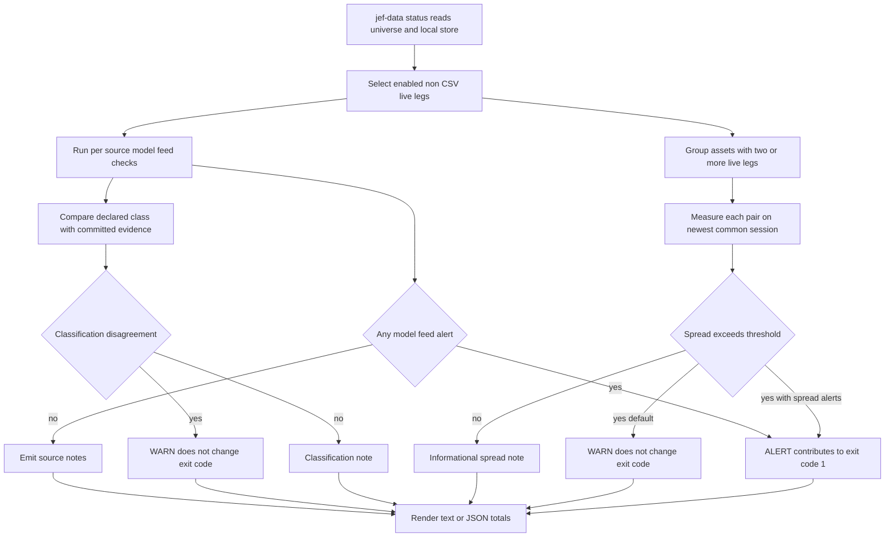

# Store Health, Status, and Alert Severity

`jef-data status` is the **read-only, offline verdict** over the locally restored EOD store. It does not fetch bars or corporate actions, require a provider key, or repair data. Its job is narrower and operationally important: after `jef-data sync` has acquired and reconciled data, decide whether the resulting store is safe enough for the daily chain to continue.

An **alert** makes `status` return exit code `1`; warnings and notes remain visible but return `0`. In the deployed path, `deploy/daily.sh` runs sync first, evaluates `status --json` exactly once, and only starts binning or publishes the store and run artifacts if that status result is zero. See [Daily Run, Telemetry, and Publication Gates](daily-run-and-publication.md) for the enclosing shell gate, [EOD Data Model, Persistence, and Adjustment](../concepts/eod-data-model-and-adjustment.md) for the fields inspected here, and [Universe Declarations and Classification Evidence](../concepts/universe-and-classification.md) for source selection and class authority.

## Scope and evaluation lifecycle

The console script `jef-data` dispatches `status` to `cmd_status()`. The command:

1. loads and validates the configured universe, then applies optional repeated `--asset` and `--provider` filters;
2. resolves the store from `--store` or the universe default;
3. excludes `yahoo-csv` legs because a committed CSV snapshot is not a live feed;
4. evaluates each remaining source from local Parquet and corporate-action files;
5. adds every pairwise cross-venue report for an asset with two or more live legs; and
6. totals `alerts` and `warnings`, renders either text or one JSON document, and returns `1` exactly when the alert total is nonzero.

The selected legs and their `asset_type` originate in the universe declaration. That class matters twice here: it chooses the expected-session calendar and determines whether a leg is eligible for corporate-action freshness checks. A declared class is operational configuration, not merely a label.



*Model-feed alerts are chain-stopping findings; classification and ordinary cross-check findings remain warnings or notes, while `--spread-alerts` can promote a spread breach to an alert.*

The diagram describes severity, not short-circuiting. The command builds reports for all selected source legs and applicable venue pairs before it sums their alert lists. A source with no rows returns early from its own detailed checks, but that does not prevent reports for other source legs or pairs.

### Daily-chain consequence

`deploy/daily.sh` runs:

```text
jef-data sync ... --summary-json out/<UTC-date>/.diagnostics/sync.json
jef-data status ... --json | tee out/<UTC-date>/.diagnostics/status.json
```

The shell has `set -euo pipefail`, captures the status pipeline result, emits best-effort diagnostics, and exits on a nonzero result before the binning and final S3 publication steps. The status attachment and the actual gate thus come from the same evaluation, rather than separate checks made at different times. A warning-only report is not a green claim about every observation; it means the configured policy did not classify any finding as a publication veto.

## Severity contract

| Severity | Where it is recorded | Process result | Meaning and normal response |
| --- | --- | ---: | --- |
| **Alert** | `alerts` list on a source or pair report | `1` if any alert exists | A modeled-feed integrity/freshness condition, or an explicitly promoted spread breach. Stop the normal daily chain, investigate and repair or verify the condition, then re-run sync/status. |
| **Warning** | `warnings` list | `0` if there are no alerts | A loud cross-check or metadata disagreement that is deliberately not treated as proof that the modeled feed is unusable. Investigate; do not mistake it for a trading signal. |
| **Note** | `notes` list | `0` if there are no alerts | Measurement or contextual evidence, including historical-series characteristics. It still may warrant model review, but does not mean today's acquisition failed. |

A warning can coexist with an alert in the same report. Text output labels a report `ALERT` before `WARN`, so operators should read the lists, totals, and per-pair details rather than infer the complete state from the leading label alone.

## Expected-session calendar and freshness

All timing calculations use the current UTC date. `expected_sessions_between(asset_type, last, today)` lists dates **strictly between** `last` and `today`: it intentionally does not expect today's bar, which may not yet be a completed session.

| Asset type family | Expected dates | Consequence |
| --- | --- | --- |
| `stock` and `etf` | Weekdays only | Weekends do not increase staleness or post-seam gaps. The check does not contain an exchange-holiday calendar, so a multi-day market closure can still accumulate expected weekdays. |
| `crypto` and any type outside that weekday set | Every calendar day | A missing calendar day counts as a missed expected session. |

This is a deliberately simple expected-session model, not an exchange trading-calendar service. Staleness text explicitly asks the operator to verify a multi-day holiday before acting. A one-day holiday normally remains below the default alert threshold.

### Source data freshness alerts

For a source with stored data, the command reads its latest date and counts expected sessions from that date to today.

- **Never filled:** no stored latest date is immediately an alert: `never filled - no stored rows (jef-data sync first)`. The per-source report returns at that point, so it has no row-count, resolution, jump, or action-freshness measurements.
- **Stale:** alert when the number of missed expected sessions is at least `--staleness` (default `2`). The check is based on the declared calendar family, not wall-clock age.
- **Today-dated bar:** when the latest stored session equals today, emit a note rather than an alert. For a session market this can represent a pre-close/intraday serve; the normal tail refresh is expected to replace it later.

Corporate actions have a separate freshness condition. Only `actions` legs—currently EODHD legs whose declared type is not `crypto`—are checked. Status reads the split-file `last_updated` stamp and counts missed **refresh sessions** with the same expected-session function:

- no stamp is an alert at every threshold;
- otherwise, an alert starts at `actions_missed_k=2` missed refresh sessions; and
- the public `status` CLI does not expose an action-freshness flag, so this command path uses that function default.

This session-based, date-quantized rule matches sync's once-per-UTC-day action refresh gate. It avoids treating a healthy Friday action refresh as stale merely because a status check runs over a weekend, and it avoids a sub-day race in which sync has just stamped an action file but a second clock-based check disagrees.

## Per-source integrity checks

`check_source()` starts with the declared-class comparison, then checks whether the store has a latest date. For a filled source it loads the complete local series and makes the following measurements. It never changes stored bars, action files, or the universe.

### Phantom-split-shaped jumps are alerts

The main `close` series is the split-adjusted, model-facing close. Status scans the newest `--window` stored rows (default `10`) for a one-row return whose absolute value is strictly greater than `--jump-threshold` (default `0.40`). A jump becomes an alert only when its date has **no same-day saved split event**.

This is a diagnostic for a missed or incorrectly recorded corporate action entering the adjusted series as a discontinuity. It is not a general volatility alarm: a same-date stored split suppresses the finding, and a move exactly equal to the threshold does not breach it. Investigate the action record and provider history; for a raw-basis EODHD series, the normal sync sequence refreshes actions before bars and re-derives model-facing values from raw columns and saved splits.

### Seam and historical-series notes

The checks below are deliberately notes. They describe the series that reaches the downstream seam or a provider's quoting behavior; many are historical facts that re-running today's acquisition cannot fix.

| Measurement | Method | Note threshold and interpretation |
| --- | --- | --- |
| Zero-volume rows | Count rows where `volume == 0`; if the longest consecutive row run exceeds one, include its length and date span. | Any count is reported. Consecutive rows matter because the seam drops them together, creating one splice; scattered zero-volume rows are a different shape. |
| Post-seam continuity | Retain only rows with `volume > 0` and a non-null main `close`. For each adjacent surviving pair, count expected sessions strictly between their dates and retain the largest gap. | Note at `--gap-k` or more absent expected sessions (default `5`). This sees both zero-volume eras and provider-omitted eras because both disappear from the seam-facing survivor sequence. |
| Price resolution | Use the newest `--resolution-window` traded sessions (default `500`): zero-volume rows, nulls, and non-positive prices are excluded. Prefer provider `close_raw`; use main `close` only when no usable raw values exist. | No measurement is emitted until at least 60 sessions survive. Otherwise report distinct closes, smallest relative gap between adjacent distinct close values, and the share of adjacent sessions with unchanged closes. |

A price-resolution note is emitted when either `distinct / sessions` is below `--resolution-k` (default `0.20`) or the flat share is above `--flat-k` (default `0.25`). Equality does not breach either comparison. The result remains a note because a coarse price grid can be an enduring property of an instrument rather than a failure of this run. It can still make event-rate or model conclusions unreliable, so treat it as a modelling review input.

The post-seam calculation uses expected sessions rather than calendar-day distance. Thus a stock's weekend contributes no missed session; conversely, it does not need a row with zero volume to identify a hole—an era missing entirely from a provider response produces the same seam-relevant absence.

## Declared-class evidence is a warning path

Classification has a different purpose from feed health. `universe.toml` remains the authority for `asset_type`, price basis, action eligibility, the crypto end guard, and the status calendar. The committed `classifications.toml` file is independent vendor evidence read locally; it cannot override configuration and it does not make a network request during status.

The comparison applies only to EODHD legs and uses store identity `(exchange, symbol)`. Its possible outcomes are rendered as follows:

| Evidence verdict | Status treatment |
| --- | --- |
| `disagree` | **Warning**: a mapped vendor type resolves to an asset type different from the declaration. |
| `agree` | Note. |
| `no_evidence` | Note requesting that classification evidence be recorded. |
| `not_comparable` | Note. In particular, vendor type `Currency` does not independently distinguish crypto from forex. |
| `unmapped` | Note rather than a guessed mapping. |

Only `Common Stock → stock` and `ETF → etf` are mapped. This narrow mapping is intentional: evidence that cannot discriminate is not agreement. The result is copied into the source report as `declared_class_check`, but a disagreement does not change status exit code because it is metadata evidence, not a demonstrated failure of the modeled series.

Keep the packaged evidence valid. Its loader rejects schema errors, unknown keys, invalid dates, and duplicate store coordinates. `cmd_status()` does not catch a classification parsing failure around per-source evaluation, so a malformed evidence file fails the command instead of quietly becoming a `no_evidence` note.

## Cross-venue close spread

After source reports, status groups enabled non-CSV legs by asset. Every asset with at least two live legs produces every pair combination; the check is a cross-check of independently stored feeds, not a replacement for the configured modeled-source decision.

For each pair, status:

1. reads both local frames; a missing frame produces a note rather than duplicating the per-source never-filled alert;
2. finds the newest date shared by the two frames' youngest `--window` rows (default `10`); if there is none, it reports that the spread was not measured and directs attention to staleness;
3. takes each frame's stored main `close` on that date, rejects a zero midpoint as unmeasurable, and otherwise calculates `abs(close_a - close_b) / ((close_a + close_b) / 2)`; and
4. always records a note with the measured spread and both prices, then compares the spread strictly to `--spread-threshold` (default `0.005`, or 0.5%).

A breach is a **warning by default**. It says that a feed may be wrong or a venue may be distressed; it is explicitly not an EOD arbitrage or trading signal. The measure may also include quote-basis differences—for example, a USD composite versus a USDT quote—because status has no separate USDT/USD conversion series.

Use `--spread-alerts` to promote a breach to an alert. This is an operator policy choice: it causes the pair's finding to join `alerts_total` and makes status return `1`, thereby stopping the daily chain. The deployed daily script does not pass this option, so its ordinary spread breaches stay non-gating warnings.

## Commands and thresholds

Typical local, offline invocations are:

```text
jef-data status --store data
jef-data status --store data --json
jef-data status --asset BTC --provider eodhd --store data
jef-data status --spread-alerts --store data
```

`--universe PATH` selects another validated universe; `--asset` and `--provider` may be repeated. Unknown filters or a selection with no enabled legs are command errors, rather than an empty healthy result. The operational knobs exposed by `status` are:

| Option | Default | Effect |
| --- | ---: | --- |
| `--staleness` | `2` | Expected sessions missing before a stale-source alert. |
| `--jump-threshold` | `0.40` | Strict absolute one-row return threshold for the phantom-split alert. |
| `--window` | `10` | Newest stored rows scanned for jumps and searched for a cross-venue common date. |
| `--resolution-window` | `500` | Most recent traded sessions used in the price-resolution measurement. |
| `--resolution-k` | `0.20` | Distinct-close/session ratio below which price resolution is noted. |
| `--flat-k` | `0.25` | Flat-close share above which price resolution is noted. |
| `--gap-k` | `5` | Post-seam absent expected sessions at which continuity is noted. |
| `--spread-threshold` | `0.005` | Relative close spread above which a pair finding is emitted. |
| `--spread-alerts` | off | Promote a spread breach from warning to alert. |

Thresholds control classifications of evidence, not data repair. In particular, raising a threshold can make the process green while leaving the underlying series condition unchanged; change a threshold only with an explicit operational reason.

## JSON and text output contract

With `--json`, stdout is one schema-versioned envelope rather than the human-readable table:

```json
{
 "schema_version": 1,
 "store": "data",
 "reports": [],
 "pairs": [],
 "alerts_total": 0,
 "warnings_total": 0
}
```

`reports` contains one per-source dictionary. Every source report begins with `asset`, `exchange`, `symbol`, `alerts`, `warnings`, and `notes`. EODHD reports also carry `declared_class_check`. Filled-source reports add `last_session`, `missed_sessions`, and `rows`; `resolution` appears only after enough traded sessions are available. A never-filled report is intentionally sparse because it returns after recording its alert.

`pairs` contains cross-venue dictionaries with `kind: "cross_venue"`, `asset`, labels `a` and `b`, `common_session`, `spread`, `threshold`, and their own severity lists. `spread` remains `null` when the pair cannot be measured; `common_session` is also `null` when no common date was found, but is retained for a zero-midpoint measurement failure. `alerts_total` includes both source and pair alerts, including promoted spreads. `warnings_total` includes both source classification warnings and cross-venue warnings.

Without `--json`, source rows show last session, missed sessions, and row count; resolution measurements and all severity messages follow as indented lines. Pair rows are rendered separately, then a summary reports the number of sources, optional venue pairs, alerts, and warnings. Automations should use the JSON keys rather than parse either presentation or finding text.

## Operating response and safe changes

### Triage order

1. **Check the actual severity and scope.** Preserve the JSON diagnostic from the one gated run. Determine whether the alert is source-specific, action-specific, or an operator-promoted pair finding.
2. **For no rows or ordinary staleness,** check the selected universe/filter and the preceding sync result before retrying. Verify a suspected extended market closure before assuming a failed feed.
3. **For action freshness or phantom-split alerts,** inspect the saved split data and provider history. Do not manually apply adjustment to a pre-adjusted series; use the configured sync lifecycle or the offline adjustment repair path only where the stored basis permits it.
4. **For seam, resolution, class, or ordinary spread findings,** treat the output as evidence for data/model review. A warning or note does not authorize ignoring it, but it does not by itself veto publication under the current policy.
5. **Re-run status after the relevant correction.** Its read-only nature makes it safe to repeat, but the deployed chain deliberately avoids two separate time-sensitive evaluations for one daily decision.

### Extension checklist

A status change is a production gate change. Preserve these boundaries when extending it:

- When adding an asset type, explicitly decide whether it belongs in `WEEKDAY_TYPES`; otherwise it falls into the every-day expected-session behavior.
- When adding a provider or source mode, explicitly decide whether it is a live leg to health-check or snapshot-like input to exclude. Preserve separate store identities for feeds being compared.
- Keep model-feed alerts distinct from redundancy/spread and classification evidence. If a new cross-check should block publication, expose an explicit promotion policy comparable to `--spread-alerts` rather than silently changing warning semantics.
- Add a vendor-type mapping only when it unambiguously maps to a representable store asset type. Do not turn unknown or ambiguous evidence into a guessed declaration.
- Treat changes to JSON keys, severity routing, and exit-code aggregation as interface changes: `daily.sh` attaches the JSON document and gates publication on the process result.

### Focused verification priorities

Use these focused verification priorities when changing the status gate. The highest-value checks are deterministic unit tests around `check_source()`, `check_cross_venue()`, and `cmd_status()` with an injected UTC time and temporary store:

1. exercise strict-exclusive expected-session counting across a weekday weekend, a single weekday holiday-shaped gap, and crypto calendar days;
2. prove each alert independently: no rows, threshold-boundary staleness, a jump with and without a same-day split, and missing or session-stale action stamps;
3. build zero-volume and omitted-row histories to distinguish the row-run note from the post-seam survivor gap, and test the 60-session resolution minimum plus both strict resolution thresholds;
4. cover every classification verdict and assert only `disagree` becomes a warning; also assert malformed committed evidence fails loudly;
5. test no pair data, no common date within the bounded window, zero midpoint, exact-threshold spread, default warning routing, and `promote_to_alert=True` routing; and
6. assert JSON totals include source warnings and pair findings, while exit `1` depends only on alert lists.

Finally, exercise the integration gate with a stubbed `jef-data`: an alerting status result must stop binning and final store/run publication, while a warning-only result must not. This protects the contract that turns the local health verdict into an operational publication decision.
