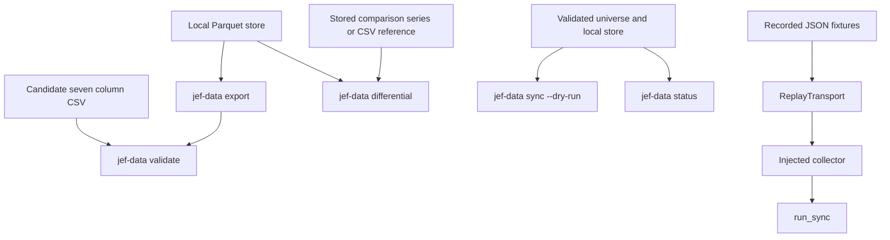

# Verification, Dry Runs, and Replay Seams

The data layer provides several complementary ways to establish confidence without treating a live provider response as a test oracle. Use the seven-column contract to reject malformed interchange data, export the local store back through that contract, quantify provider differences rather than demanding equality, and make offline plan and health decisions from local state. For behavior that would otherwise depend on time, HTTP, credentials, or a lock wait, the implementation exposes clocks, sleepers, transports, collectors, and output functions that a focused test can replace.

This page concerns repository-owned data-layer behavior. It does not establish that the external binning consumer accepts a produced file. For the storage and adjustment invariants being checked, see [EOD Data Model, Persistence, and Adjustment](../concepts/eod-data-model-and-adjustment.md); for provider normalization and credential handling, see [Market-Data Collector Integrations](../integrations/market-data-collectors.md); for the operational status verdict, see [Store Health, Status, and Alert Severity](../operations/store-health-and-alerts.md).

## Choose the verification surface

The available surfaces answer different questions. They are not substitutes for one another.



*Contract checks, offline local-state checks, differential evidence, and replay-backed sync exercise distinct verification boundaries.*

| Question | Surface | What a passing result means | What it does **not** mean |
| --- | --- | --- | --- |
| Is this CSV structurally and numerically admissible at the EOD seam? | `jef-data validate` | No contract errors were found. Notes identify policy-driven drops or advisories. | The series is long enough for every use case, economically correct, or equivalent to another provider. |
| Does the persisted series render as a valid seven-column interchange frame? | `jef-data export` followed by its built-in validation | The store was converted to the contract shape and that produced frame has no reported contract errors. | An external binning implementation successfully consumed it. |
| How do two provider or store series differ? | `jef-data differential` | Their dates align and every compared OHLCV cell is within the selected relative tolerance. | They were expected to be bit-identical or are interchangeable in every economic respect. |
| What would acquisition do with this local state? | `jef-data sync --dry-run` | The selected leg plan, including first-fill or tail windows, was derived without creating collectors. | A request, credential, provider response, or write path was exercised. |
| Is the local store healthy under the configured gate? | `jef-data status` | The current policy found no alerts when the command exits zero. | There are no warnings or notes, or that any data was fetched or repaired. |
| Will an integration behave correctly at HTTP and time boundaries? | Injected transport, limiter, clock, sleeper, collector, and `run_sync()` collaborators | The behavior was exercised against controlled inputs and deterministic time. | A real provider or credential was required. |

## Contract validation and the export round trip

### Validate raw seam input

The [contract module](../../src/jef/data/contract.py) defines the seven required columns:

```text
Date, Open, High, Low, Close, Adj Close, Volume
```

`validate(df, min_rows=...)` returns a `ContractReport`; it does not throw merely because the input is invalid. A report has two severities:

- **Errors** reject the frame: missing required columns, newly coerced non-numeric values, no parseable dates, duplicate parseable dates, negative prices or volume, and `High < Low`.
- **Notes** retain the distinction between invalid data and loader policy. They report extra columns, unparseable dates, unsorted dates, zero-volume rows, null-containing rows, and a clean-row count below the advisory minimum. The default is `1115` clean rows (`720 + 30 + 365`).

Use the command for a file-level gate:

```text
jef-data validate path/to/eod.csv
jef-data validate path/to/eod.csv --min-rows 2000
```

The command reads the CSV, prints the row count and report, and returns `1` only when `report.ok` is false. Treat an exit of zero with notes as an explicit review result, not as silence: the loader policy will sort dates and drop rows described by its notes. Code that needs exception control flow can call `validate_or_raise()`, which raises `ContractError` only when the returned report has errors.

### Check the persisted-to-contract boundary

`to_contract_frame()` is the store export adapter. It regenerates `Date` from the UTC `datetime`, uses stored main `Open`/`High`/`Low`/`Close`/`Volume`, and maps provider `adjusted_close` to `Adj Close`. It preserves all stored rows for this export; zero-volume and null-row exclusion belongs downstream at the seam. When every volume is finite and integral it emits `int64` volume, otherwise `float64`, matching the expected CSV inference behavior.

```text
jef-data export --store data --exchange eodhd --symbol AAPL.US --output /tmp/AAPL.csv
jef-data validate /tmp/AAPL.csv
```

`jef-data export` already invokes `validate()` on the generated frame and returns the report's status, so the second command is useful when a separately captured artifact needs an independent, visible check. This is the concrete store-to-contract verification path. It validates the repository-owned handoff representation, not the implementation of a downstream component that may read it.

When changing fields or adjustment code, use a small temporary store with rows before, on, and after a split, then export and validate it. Combine that with the raw-column and idempotent-adjustment checks in [EOD Data Model, Persistence, and Adjustment](../concepts/eod-data-model-and-adjustment.md); contract cleanliness alone cannot prove the adjustment factors are correct.

## Differential reports are a comparison gate, not golden equality

Provider data need not be bit-equal. `jef-data differential` compares an A store series, exported through `to_contract_frame()`, with either a B store series exported the same way or a CSV read as the B reference.

```text
jef-data differential --store data \
  --a-exchange eodhd --a-symbol AAPL.US \
  --b-csv /tmp/reference.csv

jef-data differential --store data \
  --a-exchange eodhd --a-symbol BTC-USD.CC \
  --b-exchange binance --b-symbol BTCUSDT \
  --tolerance 1e-4 --output /tmp/btc-differential.txt
```

The report indexes both frames by `Date`, reports dates unique to either side, and compares `Open`, `High`, `Low`, `Close`, `Adj Close`, and `Volume` on common dates. Per-cell difference is relative to the larger absolute value, with a zero denominator treated as `1.0`; two `NaN` values compare equal, while a `NaN` on only one side is an infinite discrepancy. For each failing column the report names the count and worst common-date value. It is successful only when there are no out-of-tolerance cells **and** no unmatched dates; the CLI returns `1` otherwise.

The CSV B path is passed directly to `pandas.read_csv`, rather than being contract-validated by `cmd_differential`. Validate a candidate CSV first so schema and basic data errors are distinguished from a meaningful provider-difference result. Conversely, do not hide zero-volume or null discrepancies by applying a downstream load transform before the comparison: the differential intentionally compares raw contract frames so those differences remain visible.

A useful change test runs the report at a known tolerance on a controlled pair and asserts both its Boolean verdict and the explanatory text categories: aligned dates, unmatched dates, within-tolerance columns, and beyond-tolerance columns. Include exact-tolerance, zero, one-sided-`NaN`, and no-common-date cases; each exercises a different comparison rule.

## Offline operational checks

### Plan sync without credentials or network

`jef-data sync --dry-run` still parses and validates the universe, applies `--asset` and `--provider` selection, opens the local store abstraction, and uses its existing dates to describe each selected leg. It does **not** construct EODHD or Binance collectors. Consequently it needs neither `EODHD_API_KEY` nor a network connection and performs no provider request, action update, ingest, reconciliation, or write.

```text
jef-data sync --dry-run --store data
jef-data sync --dry-run --store data --asset AAPL --provider eodhd --tail 10
```

Use it before changing a universe, tail, provider filter, or source bounds. Review the printed action (`sync-actions + load` versus `load`), first-fill or reconciliation window, configured end cap, crypto completed-day guard, and the explicit inverted-window no-fetch message. It is specifically a plan from current local state, so empty or stale partitions can change what it reports.

Dry run does not make bad filters harmless: unknown asset/provider names, an empty enabled selection, and `tail < 1` remain `SyncError` conditions. For the selection and window rules behind the printed plan, see [Universe Declarations and Classification Evidence](../concepts/universe-and-classification.md) and [Universe Sync and Tail Reconciliation](../workflows/universe-sync-and-reconciliation.md).

### Inspect store health without a live provider

`jef-data status` uses the universe plus local Parquet and corporate-action files; it does not instantiate a collector. It excludes `yahoo-csv` snapshot legs from live-source checks, evaluates each remaining source, optionally adds live cross-venue pairs, and exits `1` when any report has an alert. Warnings and notes—including the ordinary cross-venue spread breach—remain non-gating unless the operator requests `--spread-alerts`.

```text
jef-data status --store data
jef-data status --store data --json
jef-data status --store data --asset BTC --provider eodhd
```

Use JSON for assertions and automation rather than parsing rendered finding text. The envelope has `schema_version`, `store`, `reports`, `pairs`, `alerts_total`, and `warnings_total`; the process result is based on alerts, not warning count. The command is therefore an offline assessment of stored state, not an acquisition retry or repair tool.

For a focused status test, pass a fixed `now` to `check_source()` and construct just enough store/action state to establish one classification at a time. Cover no rows, staleness at the threshold, a split-shaped jump with and without a same-day action, action freshness, zero-volume/post-seam behavior, and alert versus warning aggregation separately. The complete predicate and severity meanings are documented in [Store Health, Status, and Alert Severity](../operations/store-health-and-alerts.md).

## Code-level seams for deterministic coverage

These are implementation interfaces, not merely suggested test techniques.

### Time, waiting, locking, and output

| Component | Replaceable collaborator | What it makes deterministic |
| --- | --- | --- |
| `RateLimiter` | `clock`, `sleep`, `utc_today` | Sliding-minute expiry, the wait duration, daily-budget exhaustion, and UTC-day reset. |
| `BaseCollector` | `sleep`, plus `max_retries` and `backoff` values | Retry backoff without wall-clock waits. |
| `ParquetStore` | `clock`, `sleep`, and `lock_timeout` | Per-symbol lock polling and timeout without a five-minute wait. |
| `run_sync()` | `now` and `out` | UTC date used for crypto end guarding and action freshness gating, plus per-leg output capture. |
| `check_source()` | `now` | Expected-session and action-freshness calculations at a stable instant. |
| `sync_actions()` and action saves | `now` | A reproducible action-file `last_updated` timestamp when directly exercising action persistence. |

The rate limiter has two independent controls: a 60-second sliding request window and a hard counter for the current UTC date. `acquire()` consumes a slot before every transport attempt, including retry attempts; a daily budget exhaustion raises `DailyBudgetExhausted` rather than sleeping until tomorrow. A deterministic test should advance the supplied monotonic clock in its fake sleeper and assert both the recorded waits and budget count.

`ParquetStore` uses the same injection pattern for its lock loop. Test lock timeout by supplying a short `lock_timeout`, controlled monotonic values, and a no-op sleeper rather than waiting for the production default. This seam does not remove the POSIX `flock` dependency; it removes elapsed time as a test dependency. Persistence tests should still exercise real temporary directories and a competing lock holder where platform support permits.

### Transport and collector substitution

Every `BaseCollector` accepts an explicit `transport` and `rate_limiter`; otherwise it constructs `HttpTransport` and `RateLimiter`. The transport protocol is intentionally small:

```text
request(method, url, params) -> TransportResponse
```

That permits a scripted transport to return statuses and bodies or raise `TransportConnectionError` without making a network call. The collector wrapper remains in play: it rate-limits each attempt, retries connection failures plus `429`/`5xx` with exponential backoff, rejects other non-`200` statuses, and turns invalid JSON into a redacted `CollectorError`. Test these branches through `get_json()` rather than calling a provider adapter's parsing logic in isolation, so retry and redaction behavior remain covered.

`run_sync()` independently accepts `eodhd_collector`, `binance_collector`, `now`, and `out`. Injected collectors are used as supplied and are not put in the runner's internally constructed-collector cache, so the runner closes only collectors it created itself. A controlled collector can record `get_eod`, `get_splits`, and `get_dividends` calls while returning known bars; an `out` list's `append` method can capture summary lines. This supports direct assertions that raw-basis EODHD actions precede bars, declared crypto uses the completed-day bound, changed tail rows become revisions, and an exception in one leg leaves later legs attempted while returning aggregate `ok=False`.

## Replay and recording fixtures

### Replay is strict and still uses collector policy

`ReplayTransport(fixture_dir)` recursively loads `.json` files except `manifest.json`. Each fixture supplies a public `request` identity and a `response` with `status` and JSON data. On request, the transport records the public key in `calls` and returns the matching response; no match raises `CollectorError` with the known fixture identities. An unexpected request is therefore fixture-coverage failure, never permission to contact the live provider.

Request identity contains an uppercased method, URL **path**, and sorted public parameters converted to strings. The host is not part of the key. `api_token` is excluded by `public_params()` because it is the sole current `SECRET_PARAMS` entry. Fixture filenames combine a path-derived slug with a short SHA-256 digest of that public identity.

Because replay is a transport underneath `BaseCollector`, it still passes through rate limiting, retries, non-`200` handling, and JSON parsing. It can deterministically exercise a recorded success or terminal replayed response, while a scripted injected transport is the right tool for a retry sequence whose repeated request must return different outcomes. In either case, a test that wants no delay must inject the collector and limiter sleepers described above.

### Record only deliberately and pass secrets explicitly

`RecordingTransport(inner, fixture_dir, secrets=())` first forwards the request to its inner transport, then writes a JSON fixture containing the public request identity and the response's parsed JSON. Before writing, it checks whether any nonempty string passed in `secrets` occurs in the serialized fixture and raises `CollectorError` instead of persisting it. It delegates `close()` to the wrapped transport.

The safety rules have separate scopes:

1. The request key always omits the named secret parameter `api_token`.
2. Error paths redact secrets registered by a collector; `EODHDCollector` registers its API key.
3. Recording scans only the literal secret values supplied to `RecordingTransport`.

A recording caller must therefore pass the active key in `secrets`, treat a scan refusal as a successful safety stop, and inspect the fixture before it is committed. The recorder does not generically discover or redact credentials embedded in a provider response. It also serializes `response.json()`, so it is appropriate for valid JSON payloads; a malformed-body test should use an injected transport returning a deliberately malformed `TransportResponse` instead of trying to record that wire case.

## A focused coverage plan

No test files are present in this inspected checkout. Source comments refer to paths such as `tests/data/test_adjust.py`, `tests/data/test_sync.py`, and `tests/data/fixtures/`, but those are comments rather than checked-in evidence that a suite can be executed here. `pyproject.toml` defines the package and the `jef-data` console script but contains no test-runner configuration. Do not invent a `pytest` command, report coverage, or claim that the referenced tests run.

If coverage is added or restored, base it on the concrete interfaces above rather than live credentials or mutable provider history:

1. **Contract/export:** construct frames for every error and note category, then create a temporary `ParquetStore`, export with `to_contract_frame()`, and assert contract fields, volume dtype behavior, and CLI exit mapping.
2. **Differential:** test alignment, unmatched dates, tolerance boundaries, zeros, and one-sided versus paired `NaN` values. Validate a CSV separately before using it as the B input.
3. **Collector policy:** use a scripted or replay transport plus fake limiter clock/sleeper to test retries, terminal failures, JSON errors, pagination caps, UTC budget reset, and redaction without delays.
4. **Fixture safety:** assert that a token changes neither public request key nor replay lookup, that an unknown replay request fails loudly, and that recording refuses the supplied secret if it appears in serialized output.
5. **Sync:** inject collectors, fixed UTC time, and output capture against a temporary store. Assert dry run constructs no collector; test action-before-bar ordering, tail revision reporting, first-fill/page-limit and inverted-window diagnostics, and aggregate-red behavior after an independent leg fails.
6. **Persistence and operations:** use a temporary filesystem plus injected store clock/sleeper for append versus reconcile semantics, lock timeout, no-op re-adjustment, and offline status severity/JSON totals. Keep action JSON durability separate from Parquet atomic-replace tests.

This plan establishes behavior at the same boundaries production uses. It makes a future suite more trustworthy than a live smoke test while preserving the explicit boundary that external binning, event, dashboard, and cloud components need their own contracts. For ownership of those boundaries, see [Data Layer Boundaries and Public Surfaces](../architecture/data-layer-boundaries.md).
