# Universe Sync and Tail Reconciliation

`jef-data sync` is the configured acquisition path for the local EOD store. It converts the validated universe into independent **asset/source legs**, applies source- and class-specific loading rules, then reports the entire batch as successful only when every selected leg succeeds. The important distinction from a simple incremental loader is that an established series is deliberately re-fetched over a short recent window so late provider corrections can replace recent rows without rewriting older history.

This page describes the batch orchestration. The declaration and classification authority are covered in [Universe Declarations and Classification Evidence](../concepts/universe-and-classification.md); persisted fields and adjustment mathematics are covered in [EOD Data Model, Persistence, and Adjustment](../concepts/eod-data-model-and-adjustment.md); HTTP behavior belongs to [Market-Data Collector Integrations](../integrations/market-data-collectors.md).

## Entrypoint and selection contract

The installed `jef-data` script dispatches to `jef.data.cli:main`. Its `sync` subcommand first calls [`load_universe()`](../../src/jef/data/universe.py#L224-L269), then passes the normalized document and command options to [`run_sync()`](../../src/jef/data/sync.py#L323-L408). `--store` overrides the universe's default store; `--universe` selects an alternate TOML file. Configuration and selection errors (`UniverseError` or `SyncError`) are rendered as `sync: ...` rather than entering a partial batch.

```text
jef-data sync --store data
jef-data sync --universe path/to/universe.toml --asset AAPL --provider eodhd
jef-data sync --tail 20 --force-actions --summary-json /tmp/sync.json
jef-data sync --dry-run --store data
```

`select_legs()` expands **every enabled source** of each enabled selected asset—not just the source marked `modeled`. This matters because the modeled marker selects the downstream feeder, while sync retains enabled redundant feeds as separately persisted series. Each resulting leg carries the asset name, provider, exchange/symbol store coordinate, declared `asset_type`, currency, and source `start`/`end` bounds. Repeated `--asset` and `--provider` options are filters, not permissive search terms: an unknown value, or a combination that produces no enabled legs, is a `SyncError`. `tail` must be at least one session.

The declared class is operational input. An EODHD leg is marked action-eligible only when its declared type is not `crypto`; this is not inferred from a `.CC` suffix. The same declaration decides raw versus pre-adjusted treatment and whether the completed-UTC-day guard applies. Changing a class on an existing partition is therefore not merely relabeling data: ordinary tail reconciliation compares served values, not a desired new basis or type. Plan a rebuild or migration when a declaration correction changes stored semantics.

## One collector leg in context

The following flowchart follows a selected collector leg through the runner. It also shows the batch boundary: a failure is retained as that leg's result and does not stop later legs, but any failed result makes the aggregate CLI outcome red.

```mermaid
flowchart TD
    Begin["Load validated universe"] --> Select["Select enabled legs after filters"]
    Select --> Each["Process one collector leg"]
    Each --> Window["Read recent stored sessions"]
    Window --> HasRows{"Stored sessions exist"}
    HasRows -- "no" --> First["First fill starts at universe start floor"]
    HasRows -- "yes" --> Tail["Tail starts at oldest of newest tail sessions"]
    First --> Crypto{"Declared type is crypto"}
    Tail --> Crypto
    Crypto -- "yes" --> Guard["Set guard to previous completed UTC day"]
    Crypto -- "no" --> Cap["Apply persistent configured end cap"]
    Guard --> Cap
    Cap --> Eodhd{"Provider is EODHD"}
    Eodhd -- "yes" --> Raw{"Declared type is non crypto"}
    Raw -- "yes" --> Fresh{"Actions forced or not refreshed today UTC"}
    Fresh -- "yes" --> Refresh["Fetch and persist splits and dividends"]
    Fresh -- "no" --> Splits["Load saved splits"]
    Refresh --> Splits
    Raw -- "no" --> Inverted{"Existing tail begins after capped end"}
    Splits --> Inverted
    Eodhd -- "no" --> Inverted
    Inverted -- "yes" --> NoFetch["Do not request and report inverted window"]
    Inverted -- "no" --> Fetch["Fetch bars with computed start and end"]
    NoFetch --> Reconcile["Reconcile supplied window"]
    Fetch --> Reconcile
    Reconcile --> Newest["Changed served rows replace stored tail rows"]
    Reconcile --> Frozen["Rows outside fetched window stay frozen"]
    Newest --> Basis{"Raw price basis"}
    Frozen --> Basis
    Basis -- "yes" --> Reapply["Reapply splits to whole stored series"]
    Basis -- "no" --> Success["Record success and revisions"]
    Reapply --> Success
    Each -- "leg exception" --> Failed["Record failure and continue"]
    Success --> More{"Another selected leg"}
    Failed --> More
    More -- "yes" --> Each
    More -- "no" --> Close["Close constructed collectors"]
    Close --> Totals["Print aggregate leg and failure totals"]
    Totals --> AnyFailed{"Any leg failed"}
    AnyFailed -- "yes" --> Red["CLI returns nonzero after all legs attempted"]
    AnyFailed -- "no" --> Green["CLI returns zero"]
```



*The sync runner uses the declared class and local store state to choose a bounded window; it keeps per-leg progress independent but makes the completed batch red when any leg failed.*

### Compute the fetch window before calling a provider

For collector legs, [`_window()`](../../src/jef/data/sync.py#L119-L153) reads only the recent stored session dates needed to determine the range.

| Store state and declaration | Computed start | Computed end |
| --- | --- | --- |
| No stored rows | Source `start`, or no lower bound when it is absent | Source `end`, when set |
| Stored rows | The oldest date among the newest `tail` stored sessions | The same persistent source `end`, when set |
| Declared crypto | Same first-fill/tail start rule | The earlier of source `end` and the previous completed UTC day; either bound may be the only one |

Thus `start` is a **first-fill floor**, while `end` is a **persistent cap**. Once rows exist, increasing or adding `start` does not re-fetch history; the tail start comes from stored state. In contrast, `end` constrains both the initial history request and each later tail request. The crypto guard protects every declared crypto provider, not merely Binance or an EODHD symbol with a particular suffix, from persisting the in-progress UTC daily bar.

There is one intentional no-fetch case for an established series. When the oldest session in its fetched tail is already later than the effective end cap, the window is inverted. The runner makes no provider request, adds an explicit detail explaining that rows lie beyond the pinned end, reconciles an empty input, and considers the leg successful. The corrective action is to review the declared bound, not to issue a provider request with `from > to`.

A distinct diagnostic protects unbounded first fills: when an empty series with no declared `start` receives exactly a collector's page limit, sync warns that the result may be only a trailing provider slice rather than full history. This is particularly relevant to endpoints with a default page size; declare a first-fill `start` and rebuild the partition if complete history is required.

### Raw EODHD is an action-aware lifecycle

A non-crypto EODHD leg gets `price_basis="raw"`. Before bars are requested, the runner checks the split file's `last_updated` stamp. It refreshes actions when the stamp is absent, has a date before the current UTC date, or `--force-actions` was supplied; otherwise it records `actions fresh`. Refresh means calling `sync_actions()`, which fetches splits and dividends and persists both action files, then loading the saved splits for the bar operation.

That ordering is load-bearing rather than cosmetic. EODHD raw-basis prices use split events for the model-facing main values, while the collector declares served volume split-adjusted. Ingest raw-izes that volume using the known split factors, so the initial load of a split-history symbol must see actions first. The action files retain dividends, but the adjustment pass is split-only; dividends are not applied to main OHLCV.

After `reconcile_bars()` lands the fetched EODHD rows, sync calls `reapply_adjustment()` for a raw-basis series that now has rows. The reapplication derives the entire stored main series from immutable-with-respect-to-adjustment `*_raw` values and current splits. It does not compound adjustment on a routine rerun, and it may be a no-op when neither raw values nor splits changed. The raw-basis reapplication is deliberately skipped for a pre-adjusted series because the adjustment function refuses such a basis as a double-adjustment risk.

A declared crypto EODHD leg takes the pre-adjusted branch: it neither fetches corporate actions nor runs the split reapplication, and stores `price_basis="split_adjusted"`. Binance legs use that same pre-adjusted store basis and have no corporate-action branch. For provider-specific requests, pagination, volume units, retries, and key handling, use the collector integration guide rather than changing these workflow rules in an adapter.

## Reconciliation policy: recent revisions, stable history

`run_sync()` deliberately does not reuse the manual `load_symbol()` append path. It supplies fetched bars to [`ParquetStore.reconcile_bars()`](../../src/jef/data/store.py#L334-L388), whose contract is replacement-oriented for the timestamps it receives:

1. The store constructs served rows using the leg's declared type, currency, price basis, saved splits, and the collector's `VOLUME_BASIS`.
2. For an existing supplied timestamp, it compares the as-served audit values: `open_raw`, `high_raw`, `low_raw`, `close_raw`, `volume_raw`, and `adjusted_close`.
3. When one or more values differ, the served row replaces the stored row and the store returns one revision record per changed cell. Identical rows retain their stored bytes; new dates append.
4. The store never receives older dates outside the computed tail window, so those rows remain **frozen-first-seen** under normal sync operation.

This is the precise meaning of *newest wins*: it is not a license for a provider to rewrite all history. It is bounded by the runner's `tail` window (default `10`), and revisions are normal observable output, not failures. The console prints each successful leg's count and revision count, echoes at most the first ten revisions for readability, and retains the full revision list in the result object and optional summary JSON.

The underlying Parquet mutations are serialized per symbol and use temporary year files followed by `os.replace()`. That protects readers from torn individual year files, but it is not a cross-file transaction and does not turn separate corporate-action JSON writes into the same durability boundary. See the data-model page before changing ordering, locks, or recovery behavior.

## Provider branches and lifecycle ownership

The universe supports three current source kinds, but only two are HTTP collector legs.

| Provider kind | Sync behavior | Important ownership boundary |
| --- | --- | --- |
| `eodhd` | Lazily constructs an `EODHDCollector`, computes a bounded window, applies the class-derived raw/action or pre-adjusted branch, fetches ascending bars, reconciles, and may reapply raw-basis adjustment. | Requires `EODHD_API_KEY` when the collector is actually constructed. The API token and HTTP retry/rate policy belong to the collector layer. |
| `binance` | Lazily constructs `BinanceCollector`, applies the crypto completed-day guard due to the declaration, fetches/reconciles bars as pre-adjusted crypto. | Daily kline pagination and base-asset volume normalization are collector semantics. No action refresh occurs. |
| `yahoo-csv` | Does not construct a collector or compute a collector window. It imports the configured local file through `ingest_yahoo_csv()` and reports imported rows. | This is a whole-file, overwrite-style, idempotent snapshot import with pre-adjusted basis, not a live tail-reconciled source. |

Collector construction is both lazy and cached per provider for the duration of a run. Consequently a CSV-only sync needs no network client, and an EODHD key is not needed unless an EODHD leg is selected. The runner accepts injected EODHD and Binance collectors plus an injectable UTC `now`; this is the seam used to make action gating and completed-day bounds deterministic. It closes only collectors it constructed itself.

`--dry-run` stops before construction and execution. It still validates the universe, selects legs, opens the local store abstraction, and prints a plan derived from local dates—whether the action/load form, first-fill/tail range, cap, and inverted condition—but makes no provider request, action update, reconciliation, or write. It is the safe way to review a changed universe or `--tail` choice without credentials or network access.

## Batch result, diagnostics, and operational consequence

The runner wraps each `_run_leg()` invocation in its own exception handler. A collector outage, credential failure, lock timeout, invalid CSV, or adjustment failure is converted into a failed result and printed as `FAILED`; subsequent selected legs are still attempted. After the loop it closes constructed collectors, prints `<legs> leg(s), <failed> failed -> store ...`, and returns `(results, ok)` where `ok` is true only if no leg failed.

[`cmd_sync()`](../../src/jef/data/cli.py#L237-L262) optionally serializes those same results through `sync_summary()`. The JSON includes a schema version, total and failed leg counts, total revised cells, aggregate `ok`, and per-leg identity, success, detail, and all revision records. It is written even when the aggregate result is red, provided the runner returned normally. The CLI then exits `0` for `ok=True` and `1` otherwise.

This behavior supports diagnosis without falsely certifying partial acquisition. In the normal deployment chain, a nonzero sync prevents the subsequent status, binning, and green-path publication stages, even though successful independent legs may have updated the local working store. Read [Daily Run, Telemetry, and Publication Gates](../operations/daily-run-and-publication.md) for that outer gate and [Store Health, Status, and Alert Severity](../operations/store-health-and-alerts.md) for the post-sync offline verdict.

## Safe changes and focused verification

Keep the following boundaries explicit when modifying sync:

- **Universe changes:** exercise parser rejection and selection for unknown filters, disabled assets/sources, empty selections, duplicate coordinates, and `tail < 1`. Verify that a multi-source asset still syncs all enabled legs even though only one is modeled.
- **Window changes:** use a temporary store with no rows and with more than `tail` rows. Assert first-fill floor versus persistent cap, the declared-crypto prior-day cap, and the established-series inverted no-fetch branch. Check the exact page-limit diagnostic for an unbounded initial response.
- **Raw EODHD changes:** inject a collector that records calls. Assert split/dividend refresh precedes `get_eod`, the once-per-UTC-day gate skips a same-day refresh, `--force-actions` overrides it, and reapplication is invoked only on raw basis after rows exist.
- **Reconciliation changes:** send changed and identical bars inside a fetched tail, plus changed-looking data outside it. Assert per-cell revision reporting and replacement only inside the supplied window; also verify the pure reapplication remains a fixed point.
- **Failure and reporting changes:** make one injected leg raise while another succeeds. Assert the later leg is attempted, the aggregate result is false, the CLI exit is nonzero, and summary JSON preserves both results and revisions.

Use fixed `now`, injected collectors, and an `out` capture with a temporary store rather than live provider history. [Verification, Dry Runs, and Replay Seams](../testing/verification-and-replay-seams.md) documents these substitution points and the replay transport boundary. Adding a provider is an end-to-end change: extend the strict universe vocabulary and default exchange mapping, construct it in `run_sync()`, provide the normalized bar and `VOLUME_BASIS` contract, and explicitly decide its price basis, action lifecycle, window semantics, retries, and deterministic tests.
